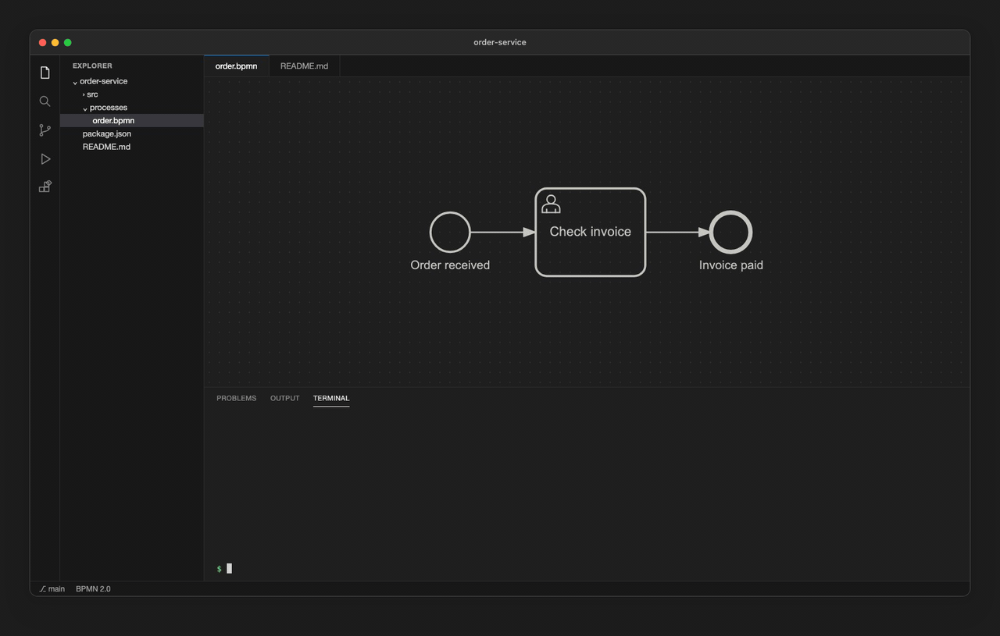

# bpmn-cli

[](https://www.npmjs.com/package/@miragon/bpmn-cli)
[](https://github.com/Miragon/bpmn-cli/actions/workflows/ci.yml)
[](LICENSE)
[](https://miragon.github.io/bpmn-cli/)

A command line tool that lets an AI agent (or a human at a shell) edit BPMN 2.0 models
**semantically**: it names elements and operations, and the CLI keeps the drawing. No BPMN XML,
no diagram coordinates.



## Why

A language model writes its answer token by token, so the time and the cost of a change grow with
the text it has to produce. BPMN XML is a lot of text, most of it diagram coordinates. An agent
that edits the XML itself is slow, and every coordinate it writes is a chance to break the file.

bpmn-cli turns this around: the agent says what should change, in one short command, and the CLI
writes the XML and the drawing. What you get:

- **Fast, because the agent writes little.** One short command replaces kilobytes of XML.
- **Cheap to read.** The agent reads a compact text view of the model instead of the XML, so
  large models fit into its context.
- **Correct by construction.** The agent names elements and changes; references, ids and
  coordinates are the CLI's job.
- **Careful with your drawing.** A diagram made in Camunda Modeler or bpmn-js stays as it is; new
  elements are fitted in next to their neighbours.
- **Ready to deploy.** Camunda 7 and Camunda 8 settings are set by name and checked before you
  deploy.

## Install

Requires Node 22.12+.

```
npm install -g @miragon/bpmn-cli   # puts `bpmn` on your PATH
brew install miragon/tap/bpmn-cli  # or with Homebrew (pulls in Node)
bpmn guide --short                 # the agent cheat sheet (`bpmn guide` for all of it)
```

## Quick start

```
$ bpmn new order.bpmn --name "Order handling"
$ bpmn add order.bpmn start "Order received"
$ bpmn add order.bpmn userTask "Check invoice" --after startEvent_orderReceived
$ bpmn add order.bpmn end "Done" --after userTask_checkInvoice
$ bpmn show order.bpmn
process orderHandling "Order handling" executable
  startEvent startEvent_orderReceived "Order received" -> userTask_checkInvoice (flow_orderReceivedToCheckInvoice)
  userTask userTask_checkInvoice "Check invoice" -> endEvent_done (flow_checkInvoiceToDone)
  endEvent endEvent_done "Done"
problems: none
```

The result is a normal `.bpmn` file that opens in Camunda Modeler / bpmn-js with a laid-out
diagram. [A worked session](https://miragon.github.io/bpmn-cli/walkthrough) builds a complete
process step by step.

## Commands

| Task | Commands |
| --- | --- |
| Read a model | `show`, `find`, `metrics` |
| Change the process | `new`, `add`, `connect`, `set`, `remove`, `retype`, `move`, `order`, `ext` |
| Change several things at once | `apply` (a batch of ops as JSON) |
| Format the diagram | `place`, `align`, `color`, `label`, `route`, `space`, `tidy`, `compact`, `layout` |
| Look at the diagram | `render` (PNG or SVG, no browser) |
| Check before deploying | `validate` (also runs the project's `.bpmnlintrc`) |
| Ask the CLI itself | `guide`, `kinds`, `--help` |

Details: [command reference](https://miragon.github.io/bpmn-cli/commands).

## Claude Code plugin

This repository is also a [Claude Code](https://code.claude.com/docs/en/plugins) plugin
marketplace. Its skill `bpmn` makes Claude use this CLI whenever a request creates or touches a
BPMN model, instead of writing BPMN XML by hand.

```
/plugin marketplace add Miragon/bpmn-cli
/plugin install bpmn-cli@miragon-bpmn
```

Details: [Claude Code plugin](https://miragon.github.io/bpmn-cli/claude-code-plugin), and the plugin
itself in [plugins/bpmn-cli](plugins/bpmn-cli/README.md).

## Camunda 7 and Camunda 8

Models can target Camunda 7 (including CIB seven and Operaton) or Camunda 8. The CLI sets the
platform's implementation details and validates them against its deploy rules.

Details: [Camunda 7 and Camunda 8](https://miragon.github.io/bpmn-cli/camunda).

## bpmnlint

A project's bpmnlint configuration (`.bpmnlintrc`) runs in `bpmn validate` and in every write: the
agent sees the findings its change added and fixes them in the same batch, instead of in CI. The
ids bpmn-cli generates follow `@miragon/rules/element-id-naming`: the prefixes and case the
`.bpmnlintrc` declares, else the rule's defaults (`userTask_checkInvoice`,
`flow_checkInvoiceToBookInvoice`), so they pass the rule out of the box
(`bpmn show <file> --conventions` lists them).

Details: [bpmnlint](https://miragon.github.io/bpmn-cli/bpmnlint).

## Library use

The package is also a library that edits BPMN in memory, in Node and in the browser.

Details: [library use](https://miragon.github.io/bpmn-cli/library), [validators](https://miragon.github.io/bpmn-cli/validators).

## Documentation

The docs site, [miragon.github.io/bpmn-cli](https://miragon.github.io/bpmn-cli/), is built from [docs/](docs/):

- [Command reference](https://miragon.github.io/bpmn-cli/commands): every command with its options
- [Syntax and output](https://miragon.github.io/bpmn-cli/reference): ids, kinds, triggers, placement, set keys, output, errors and exit codes
- [Ops JSON](https://miragon.github.io/bpmn-cli/ops): the batch format of `bpmn apply`
- [Layout and formatting](https://miragon.github.io/bpmn-cli/layout): layout modes and the diagram-only commands
- [The contract and its limits](https://miragon.github.io/bpmn-cli/contract): what the CLI guarantees, what a write changes, limitations
- [Camunda 7 and Camunda 8](https://miragon.github.io/bpmn-cli/camunda): platform settings with worked examples
- [bpmnlint](https://miragon.github.io/bpmn-cli/bpmnlint): the project's `.bpmnlintrc` in validate and every write
- [A worked session](https://miragon.github.io/bpmn-cli/walkthrough): one process from an empty file to a validated model
- [Library use](https://miragon.github.io/bpmn-cli/library)
- [Validators](https://miragon.github.io/bpmn-cli/validators): a library host's own checks inside the write
- For maintainers, in the repository only: [testing](docs/testing.md) and
  [releasing](docs/releasing.md)

## Contributing

See [CONTRIBUTING.md](CONTRIBUTING.md).

## License

[MIT](LICENSE) © Miragon GmbH.
