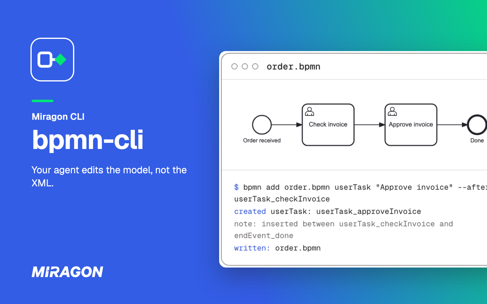
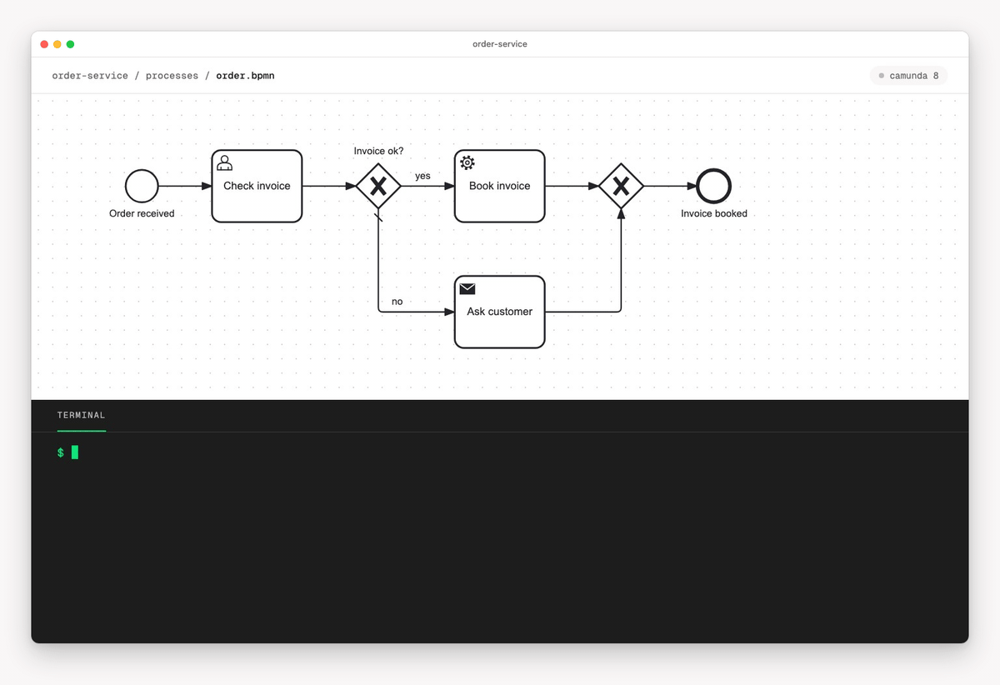

# bpmn-cli

[](https://www.npmjs.com/package/@miragon/bpmn-cli)
[](https://github.com/Miragon/homebrew-tap)
[](https://miragon.github.io/bpmn-cli/getting-started#claude-code-plugin)
[](https://github.com/Miragon/bpmn-cli/actions/workflows/ci.yml)
[](LICENSE)



A command line tool and Claude Code plugin your AI agent uses to create, read and change BPMN 2.0 models. Before 1.0, a minor release can change a command, so pin the version ([changelog](CHANGELOG.md)).

## Why

BPMN XML is long and full of coordinates, so an agent that writes it is slow and breaks it. Here the agent names the change; the CLI writes the XML and the drawing and refuses a broken one.

## What you get

- **Fast and cheap.** One command replaces kilobytes of XML; `bpmn show` reads the model as compact text.
- **Your drawing stays.** New elements fit in beside their neighbours; `bpmn layout` redraws only on request ([limits](https://miragon.github.io/bpmn-cli/contract)).
- **A picture to check.** `bpmn render` draws PNG or SVG without a browser, so the agent sees what changed.
- **Ready to deploy.** With `--target camunda7` or `camunda8`, `bpmn validate` checks the engine's deploy rules ([Camunda 7, CIB seven, Operaton and 8](https://miragon.github.io/bpmn-cli/camunda)).
- **Your lint rules, before CI.** `bpmn validate` runs your `.bpmnlintrc`, and generated ids follow its naming rule ([bpmnlint](https://miragon.github.io/bpmn-cli/bpmnlint)).



## Install

You need Node.js 24 or later; Homebrew brings it on macOS and Linux.

```sh
npm install -g @miragon/bpmn-cli   # or
brew install miragon/tap/bpmn-cli
```

Without installing: `npx -y @miragon/bpmn-cli` in place of `bpmn`. With Claude Code, add the [plugin](#with-claude-code).

## Get started

Each command prints the ids it created, such as `created startEvent: startEvent_orderReceived`:

```console
$ bpmn new order.bpmn "Order handling"
$ bpmn add order.bpmn start "Order received"
$ bpmn add order.bpmn userTask "Check invoice" --after startEvent_orderReceived
$ bpmn add order.bpmn end "Done" --after userTask_checkInvoice
$ bpmn show order.bpmn
process orderHandling "Order handling" executable
  startEvent startEvent_orderReceived "Order received" -> userTask_checkInvoice (flow_orderReceivedToCheckInvoice)
  userTask userTask_checkInvoice "Check invoice" -> endEvent_done (flow_checkInvoiceToDone)
  endEvent endEvent_done "Done"
state: 0 errors, 0 warnings (bpmn validate lists them and runs the project's lint)
```

`order.bpmn` opens in Camunda Modeler and bpmn-js; [Getting started](https://miragon.github.io/bpmn-cli/getting-started) walks through more.

## Commands

| Task | Commands |
| --- | --- |
| Read and check a model | `show`, `find`, `diagram`, `conventions`, `render`, `validate` |
| Change the process | `new`, `add`, `connect`, `set`, `remove`, `retype`, `move`, `order`, `ext add`, `ext remove` |
| Change several things at once | `apply` (a batch of operations as JSON) |
| Change only the drawing | `layout`, `place`, `color`, `label`, `route`, `space`, `tidy`, `compact` |
| Ask the CLI itself | `guide`, `--help` |

Every option: the [command reference](https://miragon.github.io/bpmn-cli/commands) or `bpmn <command> --help`.

## With Claude Code

The plugin makes Claude use the CLI instead of writing XML, and render and validate before it calls a model done. It runs `bpmn`, or `npx` when that is missing.

```txt
/plugin marketplace add Miragon/bpmn-cli
/plugin install bpmn-cli@miragon-bpmn
```

Then ask in plain words: "Add a reminder timer on Check invoice". Updates and team setup: [Claude Code plugin](https://miragon.github.io/bpmn-cli/getting-started#claude-code-plugin). Other agents run the CLI directly; `bpmn guide` is written for them.

## Help and feedback

- **Documentation:** every command and limit is at [miragon.github.io/bpmn-cli](https://miragon.github.io/bpmn-cli/).
- **Bugs and ideas:** [open an issue](https://github.com/Miragon/bpmn-cli/issues) with the `.bpmn` file and the command.
- **Library:** to edit BPMN from Node or browser code, see [Library use](https://miragon.github.io/bpmn-cli/library).

## Contributing

Building and testing: [CONTRIBUTING.md](CONTRIBUTING.md). Outside pull requests are not accepted at the moment; issues are welcome.

## License

[MIT](LICENSE) © Miragon GmbH
