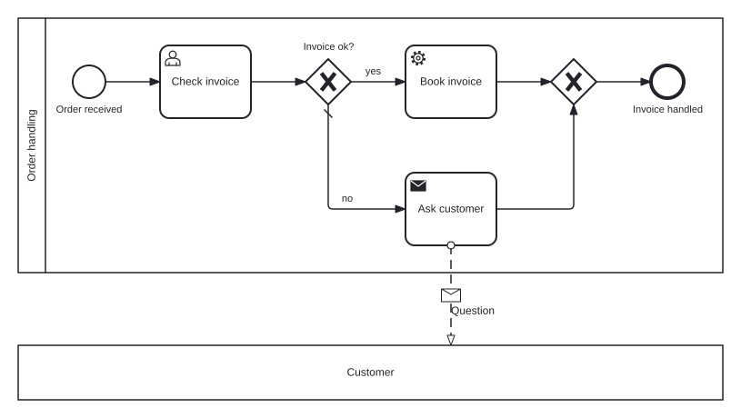

# bpmn-cli

[](https://www.npmjs.com/package/@miragon/bpmn-cli)
[](https://github.com/Miragon/bpmn-cli/actions/workflows/ci.yml)
[](LICENSE)
[](https://miragon.github.io/bpmn-cli/)

A command line tool that lets an AI agent (or a human at a shell) edit BPMN 2.0 models
**semantically**: it names elements and operations, and the CLI keeps the drawing. No BPMN XML,
no diagram coordinates.

> [!WARNING]
> bpmn-cli is experimental and has not reached 1.0.0 yet. Until then, any minor release may contain
> breaking changes to commands, flags and output. Pin an exact version and check the
> [changelog](CHANGELOG.md) before you upgrade.



## Why

A language model writes its answer token by token, so the time and the cost of a change grow with
the text it has to produce. BPMN XML is a lot of text, most of it diagram coordinates. An agent
that edits the XML itself is slow, and every coordinate it writes is a chance to break the file.

bpmn-cli turns this around: the agent says what should change, in one short command, and the CLI
writes the XML and the drawing. What you get:

- **Fast, because the agent writes little.** One short command replaces kilobytes of XML.
- **Cheap to read.** The agent reads a compact text view of the model instead of the XML, so
  large models fit into its context.
- **Correct by construction.** The agent names elements and changes; references, ids and
  coordinates are the CLI's job.
- **Careful with your drawing.** A diagram stays as it is; new elements are fitted in next to their
  neighbours, and `bpmn layout` redraws only when you ask.
- **Ready to deploy.** Camunda 7 and Camunda 8 settings are set by name and checked before you
  deploy.

## Install

Requires Node 24 or later.

```
npm install -g @miragon/bpmn-cli   # puts `bpmn` on your PATH
brew install miragon/tap/bpmn-cli  # or with Homebrew (pulls in Node)
bpmn guide                         # the core of the help, and its topics
```

## Quick start

```
$ bpmn new order.bpmn "Order handling"
$ bpmn add order.bpmn start "Order received"
$ bpmn add order.bpmn userTask "Check invoice" --after startEvent_orderReceived
$ bpmn add order.bpmn end "Done" --after userTask_checkInvoice
$ bpmn show order.bpmn
process orderHandling "Order handling" executable
  startEvent startEvent_orderReceived "Order received" -> userTask_checkInvoice (flow_orderReceivedToCheckInvoice)
  userTask userTask_checkInvoice "Check invoice" -> endEvent_done (flow_checkInvoiceToDone)
  endEvent endEvent_done "Done"
state: 0 errors, 0 warnings (bpmn validate lists them and runs the project's lint)
```

The result is a normal `.bpmn` file that opens in Camunda Modeler / bpmn-js with a laid-out
diagram. [Model a process](https://miragon.github.io/bpmn-cli/modeling) builds a complete
process step by step.

## Commands

| Task | Commands |
| --- | --- |
| Read a model | `show`, `find`, `diagram`, `conventions` |
| Change the process | `new`, `add`, `connect`, `set`, `remove`, `retype`, `move`, `order`, `ext add`, `ext remove` |
| Change several things at once | `apply` (a batch of operations as JSON) |
| Format the diagram | `place`, `color`, `label`, `route`, `space`, `tidy`, `compact`, `layout` |
| Look at the diagram | `render` (PNG or SVG, no browser) |
| Check before deploying | `validate` (also runs the project's `.bpmnlintrc`) |
| Ask the CLI itself | `guide`, `--help` |

Details: [command reference](https://miragon.github.io/bpmn-cli/commands).

## Claude Code plugin

This repository is also a [Claude Code](https://code.claude.com/docs/en/plugins) plugin
marketplace. Its skill `bpmn` makes Claude use this CLI whenever a request creates or touches a
BPMN model, instead of writing BPMN XML by hand.

```
/plugin marketplace add Miragon/bpmn-cli
/plugin install bpmn-cli@miragon-bpmn
```

Details: [Claude Code plugin](https://miragon.github.io/bpmn-cli/getting-started#claude-code-plugin), and the plugin
itself in [plugins/bpmn-cli](plugins/bpmn-cli/README.md).

## Camunda 7 and Camunda 8

Models can target Camunda 7 (including CIB seven and Operaton) or Camunda 8. The CLI sets the
platform's implementation details and validates them against its deploy rules.

Details: [Camunda 7 and Camunda 8](https://miragon.github.io/bpmn-cli/camunda).

## bpmnlint

A project's bpmnlint configuration (`.bpmnlintrc`) runs in `bpmn validate`, the gate an agent runs
before it calls a model done, so it fixes the findings instead of meeting them in CI. The ids
bpmn-cli generates follow `@miragon/rules/element-id-naming`: the prefixes and case the
`.bpmnlintrc` declares, else the rule's defaults (`userTask_checkInvoice`,
`flow_checkInvoiceToBookInvoice`), so they pass the rule out of the box
(`bpmn conventions <file>` lists them).

Details: [bpmnlint](https://miragon.github.io/bpmn-cli/bpmnlint).

## Library use

The package is also a library that edits BPMN in memory, in Node and in the browser: ten exports that
take and return strings and data.

Details: [library use](https://miragon.github.io/bpmn-cli/library).

## Documentation

The docs site, [miragon.github.io/bpmn-cli](https://miragon.github.io/bpmn-cli/), is built from [docs/](docs/):

- [Getting started](https://miragon.github.io/bpmn-cli/getting-started): install the CLI or the Claude Code plugin, a first model
- [Model a process](https://miragon.github.io/bpmn-cli/modeling): one process from an empty file to a validated model, with batches
- [Camunda 7 and 8](https://miragon.github.io/bpmn-cli/camunda): engine settings and deploy checks
- [Layout](https://miragon.github.io/bpmn-cli/layout): how a write draws, and the commands that change only the drawing
- [bpmnlint](https://miragon.github.io/bpmn-cli/bpmnlint): the project's `.bpmnlintrc` in validate, and id conventions
- [Library](https://miragon.github.io/bpmn-cli/library): the package API and host validators
- [Commands](https://miragon.github.io/bpmn-cli/commands): every command, flags and keys, kinds, output and exit codes
- [Guarantees and limits](https://miragon.github.io/bpmn-cli/contract): what a write promises and where it stops
- [Architecture](https://miragon.github.io/bpmn-cli/architecture): the modules, what each holds and what it does not do
- For maintainers, in the repository only: [testing](docs/testing.md),
  [releasing](docs/releasing.md) and the [architecture decisions](docs/adr/)

## Contributing

See [CONTRIBUTING.md](CONTRIBUTING.md).

## License

[MIT](LICENSE) © Miragon GmbH.
