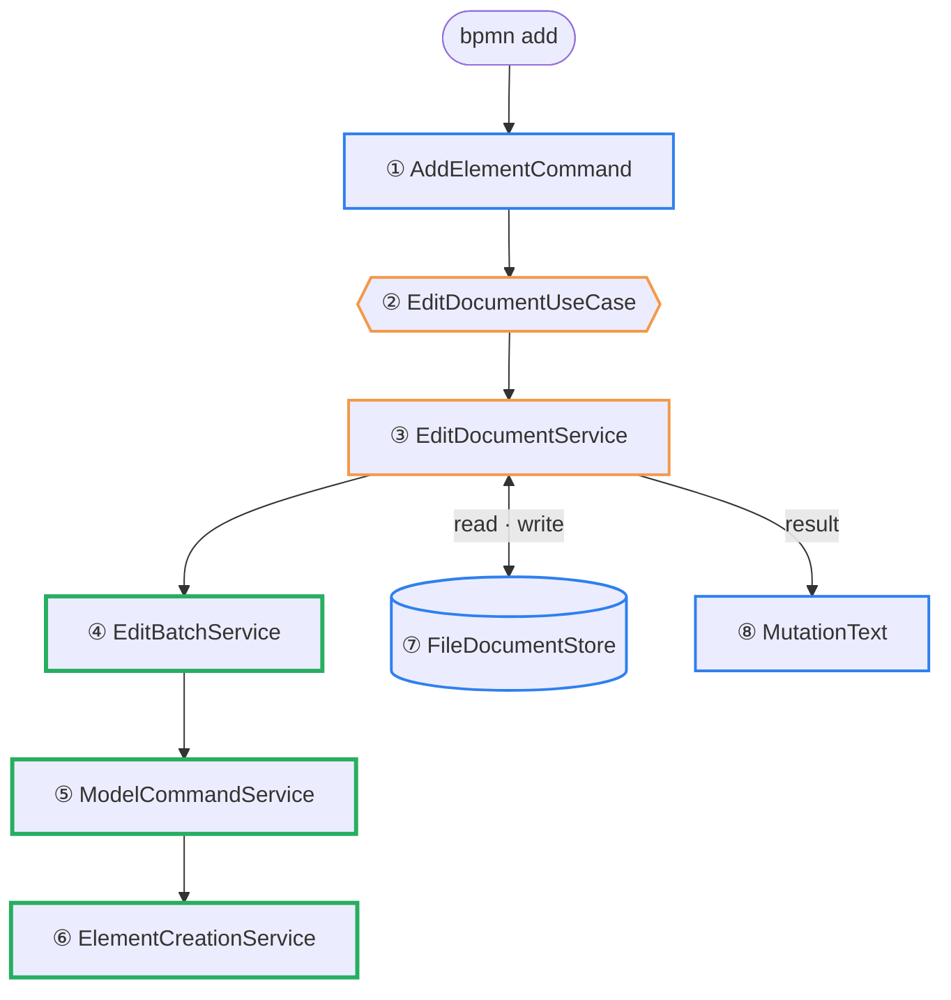
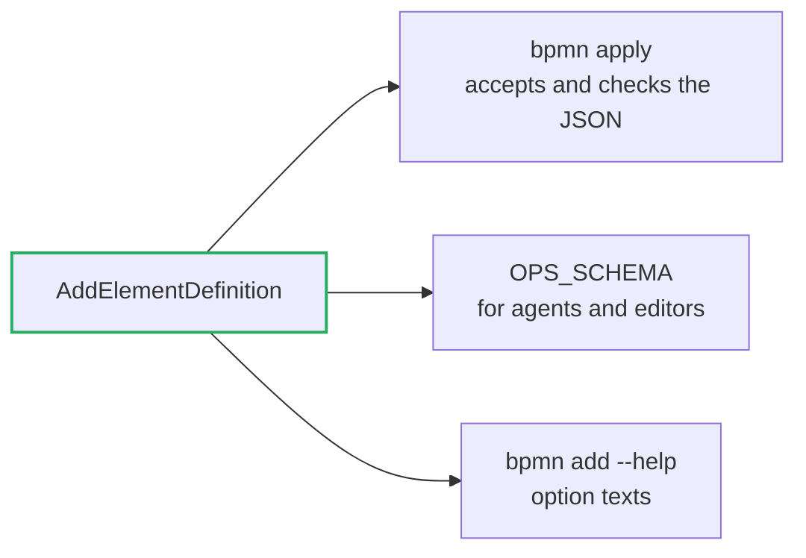

# Architecture

How `src/` is built, and how a command gets from the terminal into the BPMN model.
`test/architecture.test.ts` checks every rule on this page. The folder table and where new code
goes are in [CONTRIBUTING.md](https://github.com/Miragon/bpmn-cli/blob/main/CONTRIBUTING.md#how-the-package-is-laid-out).

## One domain, three ways in

bpmn-cli runs as the `bpmn` command, as a Node library (`@miragon/bpmn-cli/node`) and as a
browser library (`@miragon/bpmn-cli`). All three must change a model in exactly the same way.
So what a change means lives once, in the **domain**, which knows nothing about files, flags
or `process`. Around it, the **application** offers one use case per thing a caller can do.
At the edge, **adapters** translate between the outside world and those use cases. This is a
hexagonal architecture (ports and adapters).


Imports point inwards only: <span style="color:#2f80ed">adapters</span> →
<span style="color:#f2994a">application</span> → <span style="color:#27ae60">domain</span>.
The entries in the root of `src/` (`cli.ts`, `node.ts`, `api.ts`) are the only files that know
every layer. They create the services with `new` and pass the adapters in. There is no
container.

| rule (checked by the test) | why |
| --- | --- |
| `domain/` imports no application, adapter or entry | the domain runs anywhere, also in a browser |
| `application/` imports no adapter | a service does not know whether it writes to disk or to memory |
| only adapters and entries import `node:*` | the browser bundle stays free of Node |
| `adapters/in` knows use cases only by their interface | the entry decides which service is behind it |
| each service implements one use case and calls no other service | one way in, no hidden orchestration |

## The journey of `bpmn add`

```sh
bpmn add order.bpmn userTask "Check invoice" --after Event_OrderReceived
```



Eight stops, coloured by layer as in the first picture: <span style="color:#2f80ed">adapters</span>, <span style="color:#f2994a">application</span>, <span style="color:#27ae60">domain</span>. The file system (⑦) is only touched by the
service, through a port; the domain never sees it.

### ① Flags become data

`adapters/in/cli/AddElementCommand.ts` registered `add` with commander when the CLI started.
Now it checks the flags and turns them into a plain object, the same shape `bpmn apply` reads
from JSON:

```ts
const op: AddElement = {
  op: 'add',
  kind: 'userTask',
  name: 'Check invoice',
  after: 'Event_OrderReceived',
}
await this.mutate(file, [op], opts)
```

From here on nobody knows about flags any more.

### ② Through the port

`mutate()` in `adapters/in/cli/MutationCommand.ts` calls the use case. The CLI only knows the
interface `EditDocumentUseCase`; which service is behind it, `cli.ts` decided at startup.

```ts
this.cli.useCases.edit.edit({ source: { file }, commands: [op], ...opts })
```

### ③ Load, run, save

`application/service/EditDocumentService.ts` is short on purpose: get the document, let the
domain work, write the result.

```ts
const doc = await Doc.fromXml(await this.load.read(file), file)   // ⑦ read
const result = await new EditBatchService(doc, commands, opts).run(target)   // ④
await this.save.save(target, result.xml, …)   // ⑦ write
```

`this.load` and `this.save` are ports. In the CLI they are a `FileDocumentStore`, in
`applyToXml()` an `InMemoryDocumentStore`; the service cannot tell.

### ④ The batch

`domain/batch/EditBatchService.ts` runs all commands of one call on the `Doc` in memory, then
validates, lays out the drawing and writes only the changed parts back into the original text.
If anything fails, nothing is written.

### ⑤ The right service for the op

`domain/batch/ModelCommandService.ts` hands each command to the service that knows it:

```ts
switch (op.op) {
  case 'add':     return new ElementCreationService(doc, this.edit).add(op)
  case 'connect': return new ConnectionService(doc, this.edit).connect(op)
  …
}
```

### ⑥ The model changes

`domain/editing/ElementCreationService.ts` creates the user task and the sequence flow from
`Event_OrderReceived`, and reports what it did as a `ChangeSet` (created, changed, removed).

### ⑦ The file

`adapters/out/files/FileDocumentStore.ts` reads the file at ③ and writes it back atomically at
the end, through `LoadDocumentPort` and `SaveDocumentPort`.

### ⑧ The answer

Back in the CLI, `adapters/in/report/MutationText.ts` turns the result into what you see:

```text
created userTask Activity_CheckInvoice "Check invoice" - after Event_OrderReceived
created sequenceFlow Flow_OrderReceivedToCheckInvoice - Event_OrderReceived -> Activity_CheckInvoice
layout: ok - full (engine-owned diagram: redrawn)
written: order.bpmn
```

### Other ways in

- `bpmn apply` differs only at ①: it reads the commands as JSON instead of flags.
- `mutateFile()` (`node.ts`) starts at ②.
- `applyToXml()` (`api.ts`) starts at ②, with memory at ⑦ and no project `.bpmnlintrc`, and
  returns the XML instead of saving it.

From ② onwards, all of them run the same code.

## One definition per command

Each command (`add`, `connect`, …) is plain data with one **definition** in
`domain/commands/definitions/`. The definition names its fields, which of them hold ids, and
its checks. Every place that needs to know a command reads the definition, so they cannot drift
apart:



A new command therefore needs a definition, a `case` in `ModelCommandService` and a service in
`domain/editing/`. `bpmn apply` and `applyToXml()` accept it from then on. A verb of its own on
the command line (`bpmn <verb>`) is optional and lives in `adapters/in/cli/`.
