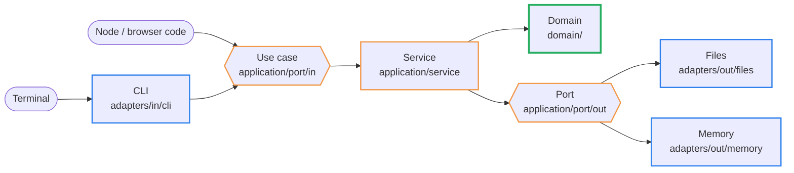
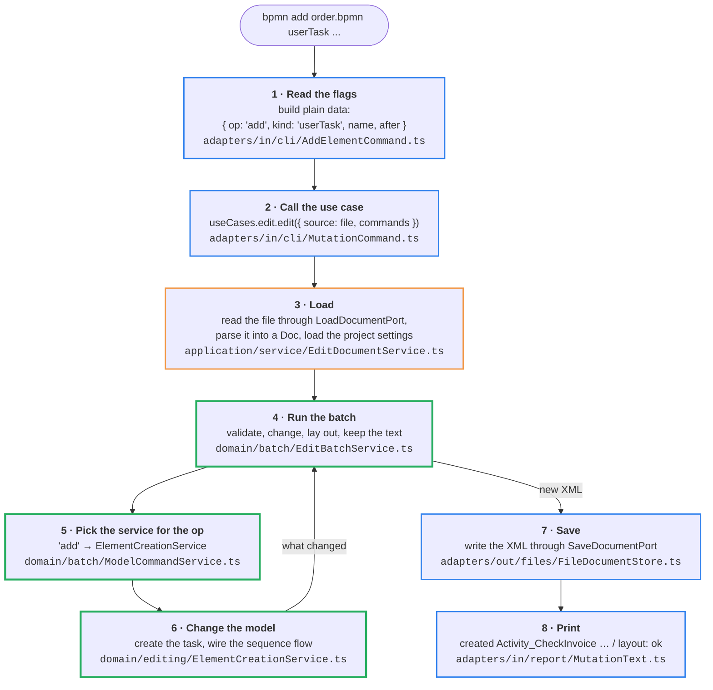
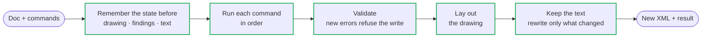
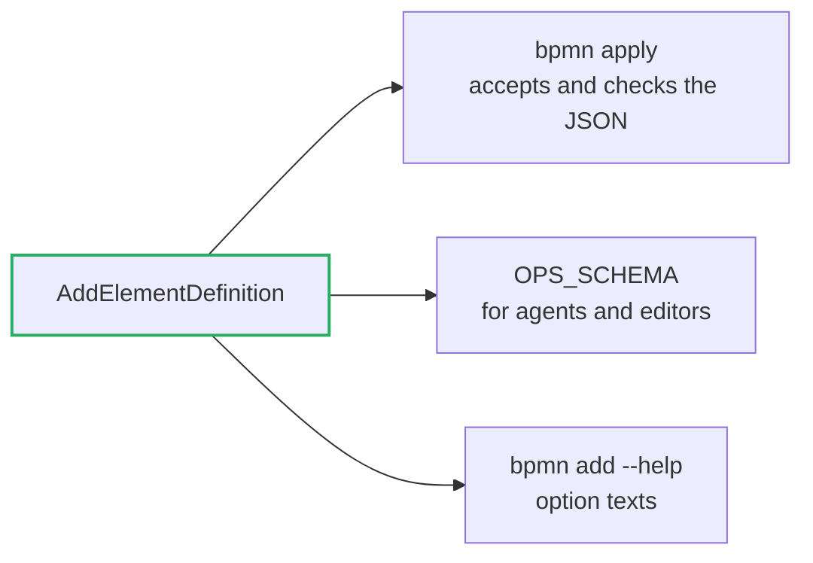

# Architecture

How `src/` is built, and how a command gets from the terminal into the BPMN model.
`test/architecture.test.ts` checks every rule on this page. The folder table and where new code
goes are in [CONTRIBUTING.md](https://github.com/Miragon/bpmn-cli/blob/main/CONTRIBUTING.md#how-the-package-is-laid-out).

## One domain, three ways in

bpmn-cli runs as the `bpmn` command, as a Node library (`@miragon/bpmn-cli/node`) and as a
browser library (`@miragon/bpmn-cli`). All three must change a model in exactly the same way.
So what a change means lives once, in the **domain**, which knows nothing about files, flags
or `process`. Around it, the **application** offers one use case per thing a caller can do.
At the edge, **adapters** translate between the outside world and those use cases. This is a
hexagonal architecture (ports and adapters).



Imports point inwards only: <span style="color:#2f80ed">adapters</span> →
<span style="color:#f2994a">application</span> → <span style="color:#27ae60">domain</span>.
The entries in the root of `src/` (`cli.ts`, `node.ts`, `api.ts`) are the only files that know
every layer. They create the services with `new` and pass the adapters in. There is no
container.

| rule (checked by the test) | why |
| --- | --- |
| `domain/` imports no application, adapter or entry | the domain runs anywhere, also in a browser |
| `application/` imports no adapter | a service does not know whether it writes to disk or to memory |
| only adapters and entries import `node:*` | the browser bundle stays free of Node |
| `adapters/in` knows use cases only by their interface | the entry decides which service is behind it |
| each service implements one use case and calls no other service | one way in, no hidden orchestration |

## Where each entry comes in

| entry | calls | adapters behind the ports | differs in |
| --- | --- | --- | --- |
| `bpmn add ...` (`cli.ts`) | `EditDocumentUseCase` through `AddElementCommand` | files + the project's `.bpmnlintrc` | reads and writes the file |
| `mutateFile()` (`node.ts`) | `EditDocumentUseCase` directly | files + the project's `.bpmnlintrc` | no flags, no printing |
| `applyToXml()` (`api.ts`) | `EditDocumentUseCase` directly | memory + no project settings | takes and returns XML, saves nothing, no `.bpmnlintrc` |

From the use case onwards, all three run the same code.

## The journey of `bpmn add`

```sh
bpmn add order.bpmn userTask "Check invoice" --after Event_OrderReceived
```



The colours are the layers from the first picture. `bpmn apply` differs only in step 1: it
reads a JSON list of the same commands instead of flags. `applyToXml()` starts at step 3,
gets the XML as a string and skips step 7.

The CLI learns about `add` at startup: `new Cli(...)` in `cli.ts` creates every command class,
and each one registers its verb and flags with commander.

## Inside the domain: one batch

A call can carry many commands (`bpmn apply`), so the domain always runs a **batch**.
`EditBatchService.run()` never touches the file system, which lets the browser run the same
code. Nothing is written unless the whole batch passes.



A few words you meet in this code:

- **Model command / diagram command**: `add`, `connect`, `set`, … change what the process
  *means*. `place`, `align`, `color`, `route`, … change only where things are *drawn*. Diagram
  commands run on the drawing, after the model commands before them.
- **Alias**: a name a batch gives to an element it creates (`"as": "check"`), so a later
  command in the same batch can refer to it before its final id is known.
- **Doc**: the parsed file, a tree of [bpmn-moddle](https://github.com/bpmn-io/bpmn-moddle)
  objects plus the original text.
- **Keep the text**: only the parts of the file that a command changed are rewritten.
  Formatting, comments and attribute order everywhere else stay as they were.

The domain folders build on each other without a cycle. `document/` (the `Doc`, ids, errors)
is at the bottom, and `batch/` is at the top, imported by nothing in the domain.

## One definition per command

Each command (`add`, `connect`, …) is plain data with one **definition** in
`domain/commands/definitions/`. The definition names its fields, which of them hold ids, and
its checks. Every place that needs to know a command reads the definition, so they cannot drift
apart:



A new command therefore needs a definition, a `case` in `ModelCommandService` and a service in
`domain/editing/`. `bpmn apply` and `applyToXml()` accept it from then on. A verb of its own on
the command line (`bpmn <verb>`) is optional and lives in `adapters/in/cli/`.
