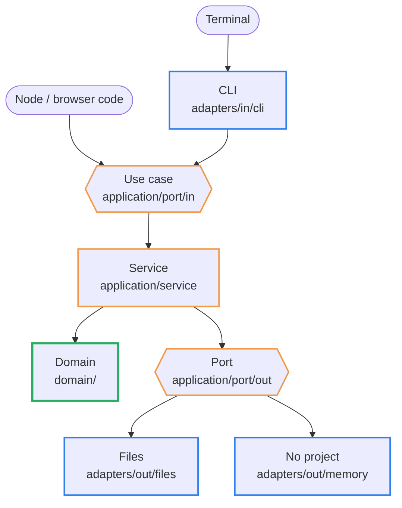
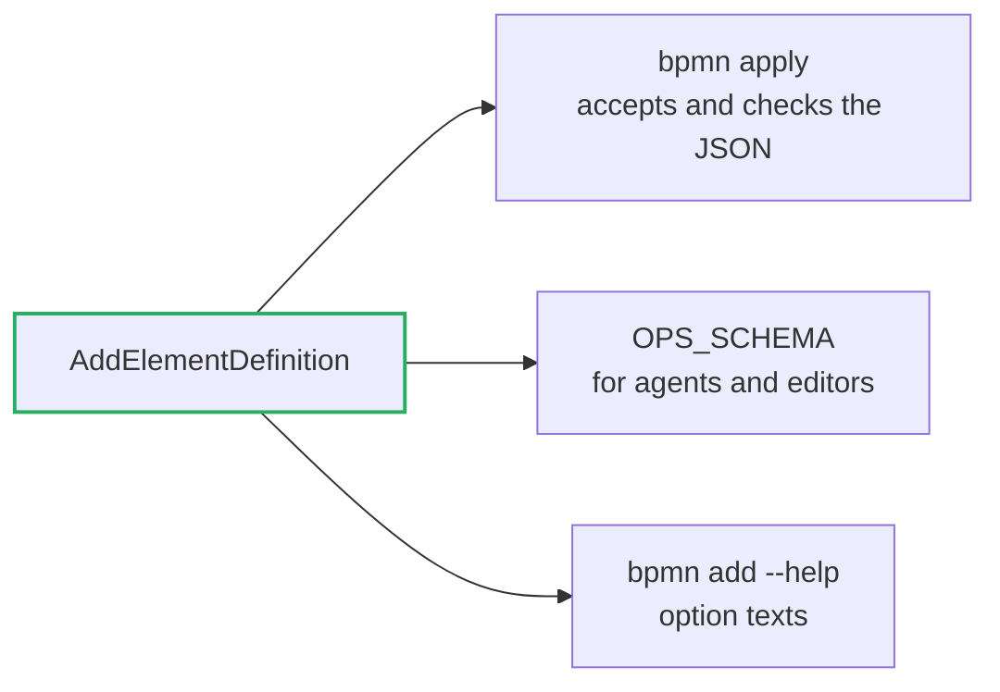

# Architecture

How `src/` is built, and how a command gets from the terminal into the BPMN model.
`test/architecture.test.ts` checks every rule on this page. The folder table and where new code
goes are in [CONTRIBUTING.md](https://github.com/Miragon/bpmn-cli/blob/main/CONTRIBUTING.md#how-the-package-is-laid-out).

## One domain, three ways in

bpmn-cli runs as the `bpmn` command, as a Node library (`@miragon/bpmn-cli/node`) and as a
browser library (`@miragon/bpmn-cli`). All three must change a model in exactly the same way.
So what a change means lives once, in the **domain**, which knows nothing about files, flags
or `process`. Around it, the **application** offers one use case per thing a caller can do.
At the edge, **adapters** translate between the outside world and those use cases. This is a
hexagonal architecture (ports and adapters).



The frame colour shows the layer: blue for adapters, orange for the application, green for the
domain. Imports point inwards only: adapters → application → domain.
The entries in the root of `src/` (`cli.ts`, `node.ts`, `api.ts`) are the only files that know
every layer. They create the services with `new` and pass the adapters in. There is no
container.

| rule (checked by the test) | why |
| --- | --- |
| `domain/` imports no application, adapter or entry | the domain runs anywhere, also in a browser |
| `application/` imports no adapter | a service does not know whether it writes to disk or does not write at all |
| only adapters and entries import `node:*` | the browser bundle stays free of Node |
| `adapters/in` knows use cases only by their interface | the entry decides which service is behind it |
| each service implements one use case and calls no other service | one way in, no hidden orchestration |

## The journey of `bpmn add`

```sh
bpmn add order.bpmn userTask "Check invoice" --after Event_OrderReceived
```


Eight stops, framed in the colours of their layer. The file system (7) is only touched by the
service, through a port; the domain never sees it.

The snippets below are the real functions, shortened: checks, options and edge cases are left
out (`…`), the calls that hand over to the next stop are kept.

### 1. Flags become data

When the CLI starts, `cli.ts` creates the `Cli`, and every command class registers its verb with
commander. For `add`, commander later calls `run()` with the parsed flags. It turns them into a
plain object, the same shape `bpmn apply` reads from JSON, and hands it on.

```ts
// src/adapters/in/cli/AddElementCommand.ts
export class AddElementCommand extends MutationCommand {
  register(program: Command): void {
    this.define(program, 'add')
      .option('--after <id>')
      .option('--before <id>')
      // …
      .action((file, kind, name, keyValues, options) =>
        this.run(file, kind, name, keyValues, options),
      )
  }

  private async run(
    file: string,
    kind: string,
    name: string | undefined,
    keyValues: string[],
    options: RawOpts,
  ) {
    const opts = this.mutationOptions(options)
    this.checkPlacementFlags(options)
    const op: AddElement = {
      op: 'add',
      kind,                       // 'userTask'
      name,                       // 'Check invoice'
      after: options['after'],    // 'Event_OrderReceived'
      // …
    }
    await this.mutate(file, [op], opts)
  }
}
```

An error thrown here reaches `Cli.run`, which prints it with its code and hint. From here on
nobody knows about flags any more.

### 2. Through the port

`mutate()` lives in the base class of every changing command. It calls the use case and prints
what comes back. The CLI only knows the interface `EditDocumentUseCase`; which service is
behind it, `cli.ts` decided at startup.

```ts
// src/adapters/in/cli/MutationCommand.ts
protected async mutate(
  file: string,
  ops: EditCommand[],
  opts: MutationFlags,
) {
  const result = await this.cli.useCases.editDocument.edit({
    ...opts,
    source: { file },
    commands: ops,
  })
  // step 8
  await this.printMutation(result, opts, this.cli.io.stdout)
}
```

```ts
// src/application/port/in/EditDocumentUseCase.ts
export interface EditDocumentUseCase {
  edit(command: EditDocumentUseCase.Command): Promise<MutationResult>
}

export declare namespace EditDocumentUseCase {
  interface Command extends FileMutationOptions {
    source: DocumentSource   // { file } or an already loaded { doc }
    commands: EditCommand[]
  }
}
```

### 3. Load, run, save

The service is short on purpose: get the document, let the domain work, write the result.
`settings`, `load` and `save` are outbound ports, handed in by the constructor; without `load`
or `save` the service takes only a document and writes nothing.

```ts
// src/application/service/EditDocumentService.ts
export class EditDocumentService implements EditDocumentUseCase {
  constructor(
    private readonly settings: LoadProjectSettingsPort,
    private readonly load?: LoadDocumentPort,
    private readonly save?: SaveDocumentPort,
  ) {}

  async edit({ source, commands, ...opts }: EditDocumentUseCase.Command) {
    // step 7: read the file
    const doc = 'doc' in source
      ? source.doc
      : await Doc.fromXml(await this.load!.read(source.file), source.file)
    const target = opts.out ?? doc.file

    // the project's .bpmnlintrc, if any
    const lint = await this.settings.lint(target, opts)

    // step 4: the domain does the work
    const batchOpts = lint.applyTo(opts, target)
    const batch = new EditBatchService(doc, commands, batchOpts)
    const result = await batch.run(target)

    // step 7: write the file
    if (!opts.dryRun) {
      result.written = await this.save!.save(target, result.xml, { … })
    }
    return result
  }
}
```

In the CLI the ports are a `FileDocumentStore` and `BpmnlintProjectSettings`; `applyToXml()`
passes only `NoProjectSettings` and a `{ doc }` with `dryRun`, so nothing is read or written.

### 4. The batch

The domain starts here. `EditBatchService` runs all commands of one call on the `Doc` in
memory, then validates, lays out the drawing and writes only the changed parts back into the
original text. If anything throws, nothing is written: the caller keeps its input.

```ts
// src/domain/batch/EditBatchService.ts
async run(file = this.doc.file): Promise<MutationResult> {
  // lossless import, Camunda 7 / 8 rules loaded
  await this.guard()

  // remember the state before: warnings already there, the drawing
  const findings = await FindingBaseline.capture(this.doc, …)
  const diagram = await BatchDrawing.capture(this.doc, …)

  // step 5: run every command on the model
  const { batch } = await this.runCommands(diagram)

  // new errors refuse the write
  await this.validate(findings, batch)

  // lay out the drawing, rewrite only what changed in the text
  const drawn = await diagram.apply(this.edit, batch.ops, batch.changes)
  const xml = await this.keptText(drawn.xml, …)

  return this.result(file, batch, xml, drawn.layout, …)
}
```

### 5. The right service for the op

`ModelCommandService` runs the commands in order and hands each one to the service that knows
it. Commands that only move shapes (`place`, `align`, `color`, …) are left for the layout in
step 4.

```ts
// src/domain/batch/ModelCommandService.ts
private dispatch(op: EditCommand): ChangeSet {
  if (isDiagramCommand(op)) return new ChangeSet()
  const { doc, edit } = this
  switch (op.op) {
    case 'add':
      return new ElementCreationService(doc, edit).add(op)
    case 'connect':
      return new ConnectionService(doc, edit).connect(op)
    case 'set':
      return new PropertyService(doc, edit).set(op)
    case 'remove':
      return new ElementRemovalService(doc, edit).remove(op)
    // … retype, move, order, ext, split
  }
}
```

### 6. The model changes

`ElementCreationService` makes the new element in the bpmn-moddle tree of the `Doc`, places it
after `Event_OrderReceived` (which creates the sequence flow), and records everything it did in
a `ChangeSet`.

```ts
// src/domain/editing/ElementCreationService.ts
add(op: AddElement): ChangeSet {
  const cs = new ChangeSet()
  // 'userTask' → bpmn:UserTask
  const { def, trigger } = ElementCreationService.resolveKind(op.kind)
  const el = this.addFlowNode(op, def, trigger, cs)
  if (op.set) {
    const values = { op: 'set', id: idOf(el), values: op.set }
    cs.merge(new PropertyService(this.doc, this.edit).set(values))
  }
  return cs
}

private addFlowNode(
  op: AddElement,
  def: KindDef,
  trigger: Trigger | undefined,
  cs: ChangeSet,
): El {
  // 'Activity_CheckInvoice'
  const id = this.edit.allocator.explicitOr(op.id, …)
  const el = this.doc.create(def.type, { id, name: op.name })
  cs.create({ id, kind: def.kind, name: op.name })

  // --after: splice in behind the anchor and add the sequence flow
  new NodePlacementService(this.doc, this.edit, op).place(el, cs)
  return el
}
```

### 7. The file

`FileDocumentStore` implements both file ports. It is the only class on this path that imports
`node:fs`.

```ts
// src/adapters/out/files/FileDocumentStore.ts
export class FileDocumentStore
  implements LoadDocumentPort, SaveDocumentPort
{
  // decoded in the encoding the XML declares
  read(file: string): Promise<string> {
    return readXml(file)
  }

  async save(target: string, xml: string, opts: SaveOptions) {
    const { source, unchanged, backup } = opts
    // a no-op leaves the file alone
    if (unchanged && target === source) return false
    if (backup && source) await FileDocumentStore.backup(source)
    // a failed write leaves the old file
    await writeAtomic(target, xml)
    return true
  }
}
```

### 8. The answer

Back in `MutationCommand`, the result becomes a report (`MutationReportBuilder`) and then text
(`MutationText`), both in `adapters/in/report/`. The library returns the same report, so the
CLI and `applyToXml()` describe a change in the same words.

```txt
created userTask Activity_CheckInvoice "Check invoice" - after Event_OrderReceived
created sequenceFlow Flow_OrderReceivedToCheckInvoice - Event_OrderReceived -> Activity_CheckInvoice
layout: ok - full (engine-owned diagram: redrawn)
written: order.bpmn
```

### Other ways in

- `bpmn apply` differs only in step 1: it reads the commands as JSON instead of flags.
- `mutateFile()` (`node.ts`) starts at step 2.
- `applyToXml()` (`api.ts`) starts at step 2, with nothing in step 7 and no project
  `.bpmnlintrc`, and returns the XML instead of saving it.

From step 2 onwards, all of them run the same code.

## One definition per command

Each command (`add`, `connect`, …) is plain data with one **definition** in
`domain/commands/definitions/`. The definition names its fields, which of them hold ids, and
its checks. Every place that needs to know a command reads the definition, so they cannot drift
apart:



A new command therefore needs a definition, a `case` in `ModelCommandService` and a service in
`domain/editing/`. `bpmn apply` and `applyToXml()` accept it from then on. A verb of its own on
the command line (`bpmn <verb>`) is optional and lives in `adapters/in/cli/`.
