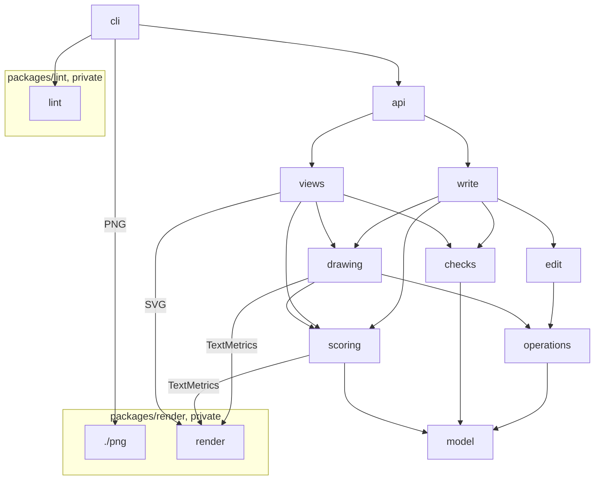

# Architecture

The map of the code: its layers, the path of one write, who finds which problem, and one section per
module in a fixed shape. `npm run architecture` (dependency-cruiser) holds the imports,
`test/contract/architecture.test.ts` holds this page's modules and names, and the rules for how code is
cut are in [CONTRIBUTING.md](https://github.com/Miragon/bpmn-cli/blob/main/CONTRIBUTING.md).

## Layers

bpmn-cli is one package with ten modules that import in one direction, and two private packages that
esbuild builds into what it ships. `src/<module>/index.ts` is the only way into a module.

- The layers, top down: cli · api · write, views · edit, drawing, checks · operations, scoring · model. A
  module may import any lower layer, never its own; the arrows show the main paths.
- Neither package imports the core. Of our code, cli imports only api, `packages/lint` and render's
  `./png`; it builds the edit commands from `OPS_SCHEMA`.
- Node builtins appear only in cli, lint and render's Node entry, so the library runs in a browser.

## One write

`bpmn add order.bpmn userTask Check --after start` becomes the operation
`{ op: 'add', kind: 'userTask', name: 'Check', after: 'start' }`, and `applyToXml` runs it:

1. `EditCommand` in cli reads the file through `BpmnFile` and calls `applyToXml`, which is one line into
   `WriteTransaction`.
2. `OperationParser` reads the operations strictly and sorts them into model and drawing operations;
   `DocumentReader` parses the XML once. Host validators run on the old file.
3. `DrawingSnapshot` records what is drawn, and `Scorer` scores it.
4. `ModelOperationRunner` applies the model operations to the semantics and records them in a `ChangeSet`.
5. `DiagramDrawing` compares the document with the snapshot and draws: incrementally at what the
   `ChangeSet` names, in full on an empty plane or with a `layout` operation. Drawing operations run last.
6. `Scorer` scores the new drawing, `ModelChecks` checks the new document once, whole, and when it has an
   error `FindingDelta` compares it with the old document, checked whole too. A new error, wherever it
   sits, refuses the write.
7. `DocumentWriter` writes only what changed; host validators run on the new text, and `FindingDelta`
   compares their findings with those from before.
8. `WriteOutcome` makes the `EditResult`, `EditResultText` prints it in at most 1 KB, and `BpmnFile` writes
   the file. Nothing is written before this step, so a refusal leaves the file as it was.

## Who finds what

Five things report problems. Two are bpmn-cli's own rules about the model, two run rules from outside,
and one judges the drawing.

| term | whose rules | asks | codes | runs | lives |
| --- | --- | --- | --- | --- | --- |
| structure checks | bpmn-cli's | is the file BPMN the CLI can read, change and draw | `E_*`, `W_*` | every write, `validate` | `checks/structure` |
| Camunda checks | bpmn-cli's | what Camunda 7 or 8 rejects at deploy, FEEL included | `W_C7_*`, `W_C8_*` | writes on executable processes, `validate` on all | `checks/camunda` |
| host validators | the embedding app's | whatever the app asks | the app's | writes, before and after; `validate`, once | `write`: `HostValidators` runs them |
| project lint | the project's `.bpmnlintrc` | the project's naming and modelling rules | bpmnlint rule names | `validate` only | `packages/lint`, handed in by cli as a validator |
| layout score | bpmn-cli's | how well the model is drawn | problem kinds such as `crossings` | every write, `diagram`, the layout's trials | `scoring` |

- checks holds only bpmn-cli's own rules. It neither runs foreign rules nor compares a before with an after.
- What a write added is told by one class, `FindingDelta`. Structure and Camunda checks it compares over the
  whole file, checking the old document only when the new one has errors; warnings are reported at the
  touched elements and counted elsewhere. Host validators run on the old file and the new one, and it compares their findings over the whole file.

## model

- Does: holds a document and writes it back byte for byte where nothing changed.
- Holds: `BpmnDocument`, `BpmnTree`, `BpmnElement`, `DocumentReader`, `DocumentWriter`, `TextPreservation`, `ChangeSet`, `DiagramIndex`, `Kinds`, `IdAllocator`, `PropertyCatalog`, `NewDocument`, `BpmnError`, the geometry values `Point`, `Box`, `Segment`, `Polyline`.
- Why: everything else reads the same tree, and a git diff of a write shows only the write because one module owns the text.
- Does not: draw, check or edit.

## operations

- Does: describes each operation once: its fields, its rules and its help.
- Holds: `OperationDefinition` with one subclass per operation, such as `AddOperationDefinition`, `OperationField`, `FieldValues`, `OperationCatalog`, `OperationParser`, `OperationSchema`, `OperationAliases`, `ReorderTarget`.
- Why: `OPS_SCHEMA`, the batch parser and the 17 edit commands come from one definition, so a new operation flag touches one place.
- Does not: apply an operation.

## edit

- Does: applies the model operations to the semantics of the document.
- Holds: `ModelOperationRunner`, one class per model operation (`ElementCreation`, `FlowConnector`, `PropertyEditor`, `ElementRemoval`, `ElementTypeChange`, `ElementMove`, `ElementOrder`, `ExtensionEditor`, `BranchSplit`), `LaneMembership`, `EditSession`, `AliasTable`.
- Why: what a change means in BPMN lives once, whichever way in it came, and drawing sees only the result.
- Does not: touch DI, the diagram's coordinates.

## scoring

- Does: judges a drawing: finds its layout problems and sums them to the layout score.
- Holds: `Scorer`, `ScoringCriterion` with one subclass per problem or group of problems, such as `OverlapCriterion`, `CrossingCriterion` and `LabelOnLineCriterion`, `DrawnPlane`, `ElementHomes`, `ProblemReport`, `ProblemKinds`, `LayoutScore`, `ScoreChange`, `ProblemLocator`.
- Why: writes, the layout, `diagram` and the tests measure with one model, and a change to the measure is a change to one module.
- Does not: change the document, lay out, read files, know the CLI or bpmnlint.

## drawing

- Does: decides coordinates: keeps a drawing and fits a change in, or draws a model in full.
- Holds: `DiagramDrawing`, `DrawingSnapshot`, `IncrementalLayout`, `FullLayout`, `DrawingOperationRunner`, `ChannelRouter`, `TrialGuard`, `ShapeSizes`.
- Why: an agent names elements, never coordinates, and a person's drawing has to survive its edits.
- Does not: change the semantics, paint, or judge itself: `TrialGuard` asks `Scorer`.

## checks

- Does: says what is wrong with the model by bpmn-cli's own rules: its structure, and what Camunda 7 or 8 rejects at deploy.
- Holds: `ModelChecks`, `StructureChecks`, `CamundaChecks`, `CamundaRules` with one subclass per theme, such as `C8FlowRules`, `RuleReporter`, `FeelParser`.
- Why: the rules ship with bpmn-cli and change with what it can keep and with Camunda's releases.
- Does not: run a host's validators or bpmnlint, compare a before with an after, judge the drawing, change the document.

## views

- Does: answers each read as data and as text.
- Holds: `ShowQuery`, `ModelView`, `ElementDetail`, `NeighbourhoodView`, `ElementFinder`, `DiagramView`, `ConventionsTable`, `KindTable`, `ImageView`, each answer with its text class beside it, such as `ModelViewText`.
- Why: the library and the CLI print the same answer, and `--json` is the same answer as data.
- Does not: write.

## write

- Does: runs one write as a transaction, and `validate`: the checks, the host validators and a layout dry run.
- Holds: `WriteTransaction`, `WriteOutcome`, `IdRenames`, `HostValidators`, `FindingDelta`, `DocumentValidation`, `NewModel`.
- Why: only a write has a before and an after, so the rules from outside and every comparison live here.
- Does not: hold rules of its own, read flags or files.

## api

- Does: is the contract: the 8 functions of `src/api/index.ts`, one line each into a class, and `OPS_SCHEMA` and `BpmnError` beside them.
- Holds: no class; it re-exports the options and results the classes below it declare.
- Why: `api-report/` holds this surface, so a change to it is a decision, not a side effect.
- Does not: hold logic or declare a type of its own.

## cli

- Does: is the Node shell: words in, files read and written, text out, exit codes.
- Holds: `Cli`, `CliProgram`, `EditCommand`, `CommandSyntax`, `NewCommand`, `ShowCommand`, `FindCommand`, `DiagramCommand`, `ConventionsCommand`, `ValidateCommand`, `ApplyCommand`, `RenderCommand`, `GuideCommand`, `CliShell`, `BpmnFile`, `LintConfigLookup`, `IdConventionsReader`, `NamingTable`, `EditResultText`, `HelpTopics`, `ProjectLintValidator`.
- Why: the CLI is a projection of the library: a command is a call or an operation, its flags the call's options or the operation's keys.
- Does not: hold model logic.

## packages/lint

- Does: runs the project's `.bpmnlintrc` through bpmnlint, for `bpmn validate`.
- Holds: `ProjectLint`, `LintConfig`, `LintPlugins`, `LintRules`, `RuleGuard`, `LintFindings`.
- Why: XML and a config go in and findings come out, so it stands alone, private until someone outside needs it.
- Does not: import the core, or run on a write.

## packages/render

- Does: paints BPMN as SVG, PNG optional, in plain Node and in a browser.
- Holds: `DiagramRenderer`, `DiagramReader`, `ShapePainter`, `EdgePainter`, `SvgComposer`, `TextMetrics`, `PngRasterizer`.
- Why: nothing else draws BPMN headless with bpmn-js quality, so it is written to be published once someone outside wants it.
- Does not: lay out, query the graph, read files.
