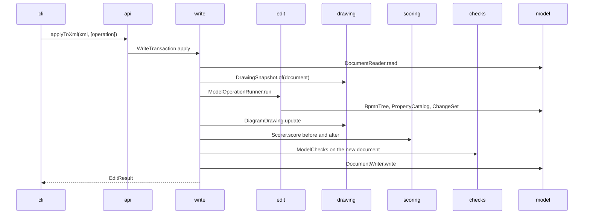

# Layers by example

What does the code in each layer look like? This page follows one change from the shell into the file
and back: a reminder on a task, a timer boundary event that fires after two days and does not cancel the
task. The snippets are sketches. Their main classes come from the [modules](modules.md#modules) table,
smaller helpers are named where they first appear, signatures settle in the steps, and all follow the
[code rules](code.md#classes): one class per file, no comments, a block for every `if`. Imports are
shown where they cross a module, since they show which layer uses which.

There is no `domain/` folder at 1.0. Today's `domain/` splits into model, operations, edit, drawing, scoring,
checks, views and write; today's `application/` and `adapters/` become write, api, cli and the two packages.

## Entries

| entry | used by | for example |
| --- | --- | --- |
| the `bpmn` binary, `bin/bpmn.js` | people, agents, the skill | `bpmn add order.bpmn userTask Check --after start` |
| `@miragon/bpmn-cli`, the library | hosts such as design-iq, in Node or in a browser bundle | `await applyToXml(xml, operations)` |
| `packages/render`, with `./png` and `./text` | the library's `renderXml` and the binary, inside their bundles | nothing from outside until it is published |
| `packages/lint` | only the binary, inside its bundle | nothing from outside |

The library has no Node entry: `./node` goes, so reading files, finding the `.bpmnlintrc` and printing
live only in cli. The binary is one esbuild bundle behind a three-line script:

```js
#!/usr/bin/env node
import { Cli } from '../dist/cli.js';

process.exitCode = await new Cli(process).run(process.argv.slice(2));
```

## The change

```text
today  bpmn add order.bpmn boundaryEvent:timer Reminder --on check --timer P2D --non-interrupting --id remind
1.0    bpmn add order.bpmn boundaryEvent:timer Reminder --on check --id remind timer=P2D nonInterrupting=true
```

What it prints today, on main 4cbec59:

```text
created boundaryEvent:timer remind "Reminder" - on check
note: attached to check
warning W_DEAD_END remind: boundaryEvent:timer remind "Reminder" has no outgoing flow  (Continue the flow (`bpmn add <file> <kind> "<Name>" --after remind`) or end it (`bpmn add <file> endEvent "<Name>" --after remind`).)
2 warnings already in the file (not repeated: `bpmn validate <file>` lists them)
layout: ok - full (engine-owned diagram: redrawn)
layout quality: score 0 -> 0
written: order.bpmn
```

What it prints at 1.0, at most 1 KB: the full redraw goes, the layout score and the counts end the text.

```text
created boundaryEvent:timer remind "Reminder" on check
warning W_DEAD_END remind: boundaryEvent:timer remind "Reminder" has no outgoing flow
  hint: continue it with `bpmn add order.bpmn <kind> "<Name>" --after remind`
written: order.bpmn
layout quality: score 0 -> 0
state: 0 errors, 3 warnings (bpmn validate lists them)
```

The same change as operation JSON, for `bpmn apply` and for the library. Each flag is a field; the keys go
under `set`:

```ts
import { applyToXml } from '@miragon/bpmn-cli';

const result = await applyToXml(xml, [
  {
    op: 'add',
    kind: 'boundaryEvent:timer',
    name: 'Reminder',
    on: 'check',
    id: 'remind',
    set: { timer: 'P2D', nonInterrupting: true },
  },
]);
```

`result.xml` is the new file, `result.created` holds `remind`, `result.findings` the dead end at
`remind`.

## Through the layers



### operations: each operation defined once

`src/operations/model/`, the model operations. Everything about the `add` operation lives in one class, `AddOperationDefinition`, an
`OperationDefinition`: each field with its type, help and rules. `OperationField`, in `operations/fields/`, builds one field from a zod/mini schema of `FieldValues`.
The module only describes operations; edit and drawing apply them. What `OperationParser` returns are values, such as
an `AddOperation`, typed as `ModelOperation` or `DrawingOperation`.

```ts
import { FieldSets, FieldValues, OperationDefinition, OperationField, type OperationOf } from '../fields/index.js';

export type AddOperation = OperationOf<AddOperationDefinition>;

export class AddOperationDefinition extends OperationDefinition {
  readonly name = 'add';

  readonly fields = {
    kind: FieldSets.kind,
    name: OperationField.optional(FieldValues.text, 'the label'),
    as: OperationField.alias('the name a later operation of the batch uses for it'),
    after: OperationField.optional(FieldValues.reference, 'append after this node, or splice into its outgoing flow'),
    on: OperationField.optional(FieldValues.reference, 'boundary events: the activity they sit on'),
    lane: OperationField.optional(FieldValues.reference, 'the lane of the node'),
    id: OperationField.optional(FieldValues.reference, 'an explicit id'),
    set: FieldSets.elementKeys,
  };
}
```

From this one class come three things: the parser that checks an `add` operation, its entry in `OPS_SCHEMA`
(the JSON Schema of all operations, which design-iq reads), and, through that entry, the flags and help of
`bpmn add`. The parser is strict, as today: a key the definition lacks is refused with `E_USAGE`, never
dropped, which zod/mini's `z.object` would do; the answer lists the keys the operation takes, for an old
key such as `timer` on `add` too. The schema entry, shortened:

```json
{
  "title": "add",
  "type": "object",
  "properties": {
    "op": { "const": "add" },
    "kind": { "type": "string", "description": "the element kind, such as userTask or boundaryEvent:timer" },
    "as": { "type": "string", "pattern": "^\\$[A-Za-z_][A-Za-z0-9_-]*$", "description": "the name a later operation of the batch uses for it", "x-batch-only": true },
    "after": { "type": "string", "pattern": "\\S", "description": "append after this node, or splice into its outgoing flow" },
    "on": { "type": "string", "pattern": "\\S", "description": "boundary events: the activity they sit on" },
    "set": { "type": "object", "description": "what the element holds: the keys of bpmn set" }
  },
  "required": ["op", "kind"],
  "additionalProperties": false
}
```

A new field of `add` is one line in `AddOperationDefinition` plus its tests; the schema, the flag and the help follow.
`x-batch-only` marks a field no flag comes of.

### cli: words in, text out

`src/cli/`. The 17 edit commands, from `bpmn add` to `bpmn space`, have no class of their own. One class,
`EditCommand`, serves them all: it knows how to run an operation from the shell, not which operation it runs.

- `CommandSyntax` describes one command: its name, its positionals (`<file> <kind> [name]`), and its
  flags and help, read from the operation's entry in `OPS_SCHEMA`, a field in kebab case. It turns the words
  into a `CommandInput`: the path, the operation with the `key=value` words under `set`, and the shared flags.
- `BpmnFile` reads and writes the `.bpmn` file; `IdConventionsReader` reads the id conventions from the
  nearest `.bpmnlintrc`, through the plugin's `./naming`.
- `EditResultText` prints the result; `ExitCode` holds the code the binary exits with.

`Cli` registers one `EditCommand` per edit command, then the nine commands that are not an operation: `NewCommand`,
`ShowCommand`, `FindCommand`, `DiagramCommand`, `ConventionsCommand`, `ValidateCommand`,
`ApplyCommand`, `RenderCommand` and `GuideCommand`.

```ts
import { Command } from 'commander';

export class Cli {
  constructor(private readonly process: NodeJS.Process) {}

  async run(words: string[]): Promise<number> {
    const shell = CliShell.of(this.process);
    const program = new Command('bpmn');

    for (const syntax of CommandSyntax.editCommands()) {
      new EditCommand(syntax, shell).register(program);
    }
    for (const command of shell.ownCommands()) {
      command.register(program);
    }

    await program.parseAsync(words, { from: 'user' });
    return shell.exit.code;
  }
}
```

`CliShell` bundles what every command shares: the file, the conventions reader, the result text, the
exit code and stdout.

```ts
import type { Command } from 'commander';
import { applyToXml } from '../../api/index.js';

export class EditCommand {
  constructor(
    private readonly syntax: CommandSyntax,
    private readonly shell: CliShell,
  ) {}

  register(program: Command): void {
    const command = program.command(this.syntax.name);
    for (const positional of this.syntax.positionals()) {
      command.argument(positional.usage, positional.help);
    }
    for (const flag of this.syntax.flags()) {
      command.option(flag.usage, flag.help);
    }
    command.action((...words: unknown[]) => this.run(this.syntax.parse(words)));
  }

  private async run(input: CommandInput): Promise<void> {
    const { file, conventions, text, exit } = this.shell;
    const xml = await file.read(input.path);
    const result = await applyToXml(xml, [input.operation], {
      force: input.force,
      conventions: await conventions.near(input.path),
    });
    if (!input.dryRun) {
      await file.write(input.output ?? input.path, result.xml);
    }
    exit.set(text.print(result, input.json));
  }
}
```

What `bpmn add --help` then prints, shortened:

```text
Usage: bpmn add <file> <kind> [name] [key=value...]

Options:
  --after <id>   append after this node, or splice into its outgoing flow
  --on <id>      boundary events: the activity they sit on
  --lane <id>    the lane of the node
  --id <id>      an explicit id
  -o <file>      write to another file, - for stdout
  --dry-run      run everything, write nothing
  --force        write despite new errors
  --json         print the result as JSON
```

cli knows files, words, text and exit codes; of the core it imports only api, and it does not know what
a timer is.

### api: one line into a class

`src/api/`. The eight functions of the contract are the only free functions, and each is one line:

```ts
import { WriteTransaction } from '../write/index.js';

export function applyToXml(xml: string, operations: Operation[], options: EditOptions = {}): Promise<EditResult> {
  return new WriteTransaction(options).apply(xml, operations);
}
```

### write: one write, one transaction

`src/write/`. It parses once, takes the drawing's snapshot and the layout score before edit runs,
scores and checks the new document once, and serialises once. It is the only module that imports edit,
drawing, scoring and checks together.

```ts
import { ModelChecks } from '../checks/index.js';
import { DiagramDrawing, DrawingSnapshot } from '../drawing/index.js';
import { ModelOperationRunner } from '../edit/index.js';
import { DocumentReader, DocumentWriter } from '../model/index.js';
import { OperationParser } from '../operations/index.js';
import { Scorer } from '../scoring/index.js';

export class WriteTransaction {
  constructor(private readonly options: EditOptions) {}

  async apply(xml: string, input: unknown[]): Promise<EditResult> {
    const operations = new OperationParser().parse(input);
    const document = await new DocumentReader().read(xml);
    const snapshot = DrawingSnapshot.of(document);
    const scorer = new Scorer();
    const scoreBefore = scorer.score(document);

    const changes = new ModelOperationRunner(document, this.options.conventions).run(operations.model);
    await new DiagramDrawing(document).update(snapshot, changes, operations.drawing);
    const score = scoreBefore.to(scorer.score(document));

    const findings = new ModelChecks(document).all();
    const written = new DocumentWriter().write(document);
    const added = await new HostValidators(this.options.validators).added(xml, written);

    return EditResult.of({ xml: written, changes, findings, added, score });
  }
}
```

- `EditResult.of` keeps the findings at the touched elements and counts the others in `state`. When the
  new document has an error anywhere, the old document is checked whole, to tell a new error from one the
  file already had; a new error without `force` refuses the write with a `BpmnError`, and with `force` it
  is reported in `findings`, even at an element the write did not touch.
- `scoreBefore.to(...)` keeps both scores, the counts per kind and the problems the write added and
  resolved; the text prints them as `layout quality: score 0 -> 0`, as today
  ([layout score](modules.md#layout-score)).
- `HostValidators` sits in write beside the transaction: it runs the host's own validators on the old file,
  then on the new one, each with its `phase`, as today, and asks `FindingDelta` which findings the change added; `EditResult.of` asks it the
  same for the structure and Camunda checks. checks holds no foreign rules and compares nothing
  ([who finds what](README.md#who-finds-what)).

### edit: the operation applied to the semantics

`src/edit/`. `ModelOperationRunner` hands each model operation to its class (`add` to `ElementCreation`);
`AddOperation` is a parsed `add` operation, as `OperationParser` returns it. Edit changes BPMN elements and records what it did in the `ChangeSet`; it never
touches coordinates.

```ts
import type { BpmnElement, BpmnTree, ChangeSet, IdAllocator } from '../model/index.js';
import type { AddOperation } from '../operations/index.js';

export class ElementCreation {
  constructor(
    private readonly tree: BpmnTree,
    private readonly ids: IdAllocator,
    private readonly properties: PropertyEditor,
  ) {}

  attach(operation: AddOperation, changes: ChangeSet): BpmnElement {
    const host = this.tree.byId(operation.on);
    const event = this.tree.containerOf(host).add('bpmn:BoundaryEvent', {
      id: this.ids.next(operation.kind, operation.id),
      name: operation.name,
      attachedToRef: host,
    });

    this.properties.set(event, operation.set, changes);
    changes.recordCreated(event);
    return event;
  }
}
```

`containerOf` gives the process or sub-process that holds the host, so a task inside a sub-process gets
its boundary event there. `PropertyEditor` writes the keys, for `add` as for `set`:

```ts
import { PropertyCatalog, type BpmnElement, type ChangeSet } from '../model/index.js';

export class PropertyEditor {
  set(element: BpmnElement, keys: Record<string, unknown>, changes: ChangeSet): void {
    for (const [key, value] of Object.entries(keys)) {
      const property = PropertyCatalog.of(element).entry(key);
      this.writerFor(property).write(element, value);
      changes.recordChanged(element, key);
    }
  }
}
```

### model: the document, and what each key means

`src/model/`. Every other module reads the BPMN through it. `BpmnDocument` holds the parsed file,
`BpmnElement` wraps one moddle object, `PropertyCatalog` says which keys an element takes, and
`DocumentWriter` writes the file back byte for byte, so only the changed lines change.

```ts
const document = await new DocumentReader().read(xml);
const check = document.tree.byId('check');
const timer = PropertyCatalog.of(check).entry('timer');
```

The last line refuses: a user task takes no timer. The refusal is the same as today's for
`bpmn set order.bpmn check timer=P2D`:

```text
error E_UNKNOWN_KEY: Unknown key "timer" for userTask check
  candidates: id, name, doc, default, loop, cardinality, completion, loop.<key>, lane, isForCompensation, startQuantity, completionQuantity, implementation, <prefix>:<attr>
```

### drawing: coordinates for what changed

`src/drawing/`. An empty plane is drawn in full, and so is a batch with a `layout` operation; otherwise the
drawing changes incrementally, at the elements the `ChangeSet` names. `DrawingOperationRunner` then runs the
other drawing operations of the batch; a `DrawingOperation` is one of them as `OperationParser` returns it. Here the reminder
lands on the edge of the task; nothing else moves.

```ts
import type { BpmnDocument, ChangeSet } from '../model/index.js';
import type { DrawingOperation } from '../operations/index.js';

export class DiagramDrawing {
  constructor(private readonly document: BpmnDocument) {}

  async update(before: DrawingSnapshot, changes: ChangeSet, operations: readonly DrawnOperation[]): Promise<DrawingReport> {
    if (before.isEmpty() || operations.some((operation) => operation.op === 'layout')) {
      new FullLayout(this.document, changes.expansions).draw();
    } else {
      await new IncrementalLayout(this.document, before).place(changes);
    }
    new DrawingOperationRunner(this.document).run(operations);
  }
}
```

`update` is async because a new pool or sub-process takes its block from a full drawing of a parsed copy. `DrawnOperation` is a `DrawingOperation` or an `order`: an `order` of lanes or pools is a model operation whose bands drawing restacks, so write passes those in `operations` too. When the incremental layout cannot place a change, the write fails with `E_LAYOUT_INCREMENTAL` and the
hint to end the batch with a `layout` operation, which then skips the incremental placement; the user's drawing
is never replaced behind their back.

### scoring: the layout score

`src/scoring/`. `Scorer` runs every criterion on every plane and sums what they report. It reads the
drawing and changes nothing; write asks it before and after, drawing asks it while it tries a move.

```ts
import type { BpmnDocument } from '../model/index.js';
import { CrossingCriterion } from './flows/CrossingCriterion.js';
import { LabelOnLineCriterion } from './labels/LabelOnLineCriterion.js';
import { DrawnPlane } from './plane/DrawnPlane.js';
import type { ScoringCriterion } from './plane/ScoringCriterion.js';
import { ProblemReport } from './plane/ProblemReport.js';
import { OverlapCriterion } from './shapes/OverlapCriterion.js';

export class Scorer {
  private readonly criteria: ScoringCriterion[] = [
    new OverlapCriterion(),
    new CrossingCriterion(),
    new LabelOnLineCriterion(),
  ];

  score(document: BpmnDocument): LayoutScore {
    const report = new ProblemReport(document.importWarnings);
    for (const plane of DrawnPlane.allOf(document)) {
      for (const criterion of this.criteria) {
        criterion.run(plane, report);
      }
    }
    return LayoutScore.of(report.problems());
  }
}
```

The list is shortened; there are 22 criteria. Each extends `ScoringCriterion`, names the kinds it reports and
looks at one thing:

```ts
import type { ProblemKind } from './ProblemKinds.js';

export abstract class ScoringCriterion {
  abstract readonly kinds: readonly ProblemKind[];

  abstract run(plane: DrawnPlane, report: ProblemReport): void;
}
```

```ts
import { ScoringCriterion } from '../plane/ScoringCriterion.js';

export class OverlapCriterion extends ScoringCriterion {
  readonly kinds = ['overlaps'] as const;

  run(plane: DrawnPlane, report: ProblemReport): void {
    for (const [first, second] of plane.leafPairs()) {
      if (first.box.overlaps(second.box) && !first.sitsOn(second)) {
        report.add('overlaps', [first.id, second.id]);
      }
    }
  }
}
```

`OverlapCriterion.test.ts` reads two small fixtures: two tasks on top of each other give one `overlaps`
with both ids; a boundary event on the edge of its task gives none. A new kind of problem is one new
criterion class, its fixtures and one entry in `ProblemKinds`.

### checks: what is wrong

`src/checks/`. bpmn-cli's own rules about the model: structure checks say what BPMN the CLI cannot keep,
Camunda checks what Camunda refuses.
Here the structure checks find one problem at the touched element: the reminder leads nowhere
(`W_DEAD_END`). Camunda rules are grouped by theme, as today, one class per group in `camunda/c7/` and
`camunda/c8/`; `CamundaRules` is their base class, and `RuleReporter` collects what they report. Today's
complex gateway check for Camunda 8:

```ts
import type { BpmnElement } from '../../../model/index.js';

export class C8FlowRules extends CamundaRules {
  check(element: BpmnElement, reporter: RuleReporter): void {
    if (element.is('bpmn:ComplexGateway')) {
      this.complexGateway(element, reporter);
    }
  }

  private complexGateway(gateway: BpmnElement, reporter: RuleReporter): void {
    reporter.deploy({
      code: 'W_C8_DEPLOY_UNSUPPORTED',
      element: gateway,
      message: 'Camunda 8 does not support complex gateways and refuses the file',
      fix: { op: 'retype', id: gateway.id, kind: 'inclusiveGateway' },
    });
  }
}
```

- The fix is plain operation JSON: a host can apply it as it is, and the CLI prints it as
  `hint: bpmn retype order.bpmn <id> inclusiveGateway`.
- `check(element, reporter)` has the shape of a bpmnlint rule's `check(node, reporter)`, and
  `BpmnElement` wraps the same moddle object bpmnlint passes. That keeps the way open to run these rules
  through bpmnlint ([triggers](README.md#triggers)).

### views: answers to reads

`src/views/`. Each read has its function in api and its answer in views: `showXml` asks a `ShowQuery`,
`findXml` an `ElementFinder`, `diagramXml` a `DiagramView`. Each answer is data with a text class
beside it, which prints what the command shows; `--json` prints the data. `ShowQuery` picks between the
outline, a part of it, and one element, so `show` returns one of two shapes, told apart by `kind`:

```ts
import type { BpmnDocument } from '../model/index.js';

export class ShowQuery {
  constructor(
    private readonly document: BpmnDocument,
    private readonly options: ShowOptions,
  ) {}

  answer(): ShowResult {
    const { id, around, depth = 1 } = this.options;
    if (id !== undefined) {
      return new ElementDetail(this.document).answer(id);
    }
    if (around !== undefined) {
      return new NeighbourhoodView(this.document).answer(around, depth);
    }
    return new ModelView(this.document).answer(this.options.in);
  }
}
```

`bpmn show order.bpmn remind` prints at 1.0 everything needed to change the element, today's `show`,
`show --context` and `ext list` in one:

```text
boundaryEvent:timer remind "Reminder"
in: Process_Order · lane sales
on: check (non-interrupting)
to: none
attrs: timer=P2D
```

`bpmn find order.bpmn --kind task` lists ids, one line each, id first:

```text
check         userTask     "Check"          sales
sendInvoice   sendTask     "Send invoice"   billing
```

### packages/lint: project lint in `validate`

`packages/lint/`, named `@miragon/bpmn-lint` in the workspace. Only `bpmn validate` runs it. It reads
the project's `.bpmnlintrc`, loads its plugins and moddle extensions, parses the XML with its own moddle
and runs bpmnlint; it imports nothing of the core. `LintInput` is the XML, the platform and the import
warnings the core already reported.

```ts
export class ProjectLint {
  static at(configPath: string): ProjectLint {
    const config = new LintConfig(configPath);
    return new ProjectLint(config, new LintPlugins(config));
  }

  async run(input: LintInput): Promise<LintFinding[]> {
    const { rules, unavailable } = await this.loaded();
    const { rootElement, warnings } = await this.plugins.moddle().fromXML(input.xml);
    const guard = new RuleGuard(this.plugins);
    const linter = this.plugins.linter({ config: { rules }, resolver: guard.resolver() });
    const reports = await linter.lint(rootElement);
    return new LintFindings(input.platform, input.importWarnings).ofReports(reports, rootElement, guard.failures);
  }
}
```

`ValidateCommand` hands it to `validateXml` as a validator, through `ProjectLintValidator` in cli:

```ts
import type { LintFinding, ProjectLint } from '@miragon/bpmn-lint';
import type { Validator, ValidatorContext } from '../../api/index.js';

export class ProjectLintValidator implements Validator {
  readonly name = 'bpmnlint';

  constructor(private readonly lint: ProjectLint) {}

  validate(xml: string, context: ValidatorContext): Promise<LintFinding[]> {
    const { platform, importWarnings } = context;
    return this.lint.run({ xml, platform, importWarnings });
  }
}
```

### packages/render: the image

`packages/render/`, named `@miragon/bpmn-render` in the workspace. `bpmn render order.bpmn --around
remind -o reminder.png` goes from cli to `renderXml`; views turns `--around` into the ids to crop, and
render paints them. Drawing uses only `./text`, for label sizes. The API is on the
[modules page](modules.md#render-package).

### a mirrored test

`test/edit/ElementCreation.test.ts` mirrors `src/edit/ElementCreation.ts`. The input is a BPMN fixture
from `corpus/`, read through `test/support/`, never built with the edit API; the name is a sentence about
BPMN.

```ts
import { describe, expect, it } from 'vitest';
import { ElementCreation } from '../../src/edit/ElementCreation.js';
import { PropertyEditor } from '../../src/edit/PropertyEditor.js';
import { Fixtures } from '../support/Fixtures.js';

describe('ElementCreation', () => {
  it('attaches a timer boundary event to the task it sits on', async () => {
    const { document, changes } = await Fixtures.edit('order-check.bpmn');
    const creation = new ElementCreation(document.tree, document.ids, new PropertyEditor());

    const event = creation.attach(
      { kind: 'boundaryEvent:timer', on: 'check', set: { timer: 'P2D' } },
      changes,
    );

    expect(event.is('bpmn:BoundaryEvent')).toBe(true);
    expect(changes.createdElements()).toEqual([event]);
  });
});
```
