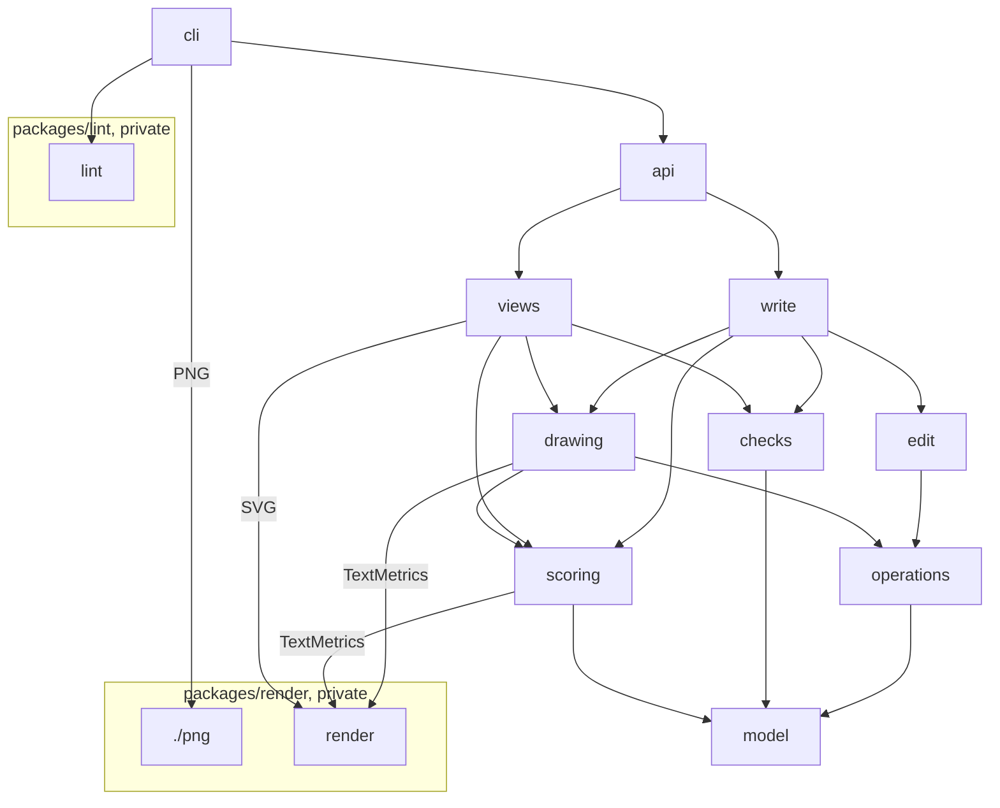

# Packages, modules and the contract

Which part does what at 1.0, and which way do imports go? bpmn-cli 1.0 is one core package with ten
modules that import in one direction, and two private packages beside it, render and lint.
What the code of each looks like, along one change: [layers by example](layers.md).

## Packages

A part that stands alone, takes plain BPMN in and is tested without the core becomes a package in
`packages/`. It is published only when someone outside bpmn-cli needs it ([triggers](README.md#triggers));
until then it stays private, and esbuild builds it into what bpmn-cli ships: render into the library and
the CLI, lint into the CLI. The core lists a private package's dependencies again, at the same versions,
since its bundles load them at run time, and API Extractor rolls render's public types into the core's
`.d.ts`.

| part | package | why |
| --- | --- | --- |
| render | private: `packages/render`, built into the library and the CLI | BPMN in, SVG or PNG out, headless, nothing of the core; nothing else draws BPMN in plain Node with bpmn-js quality, so it is written to be published as `@miragon/bpmn-render` once someone outside wants it ([below](#render-package)) |
| project lint | private: `packages/lint`, built into the CLI | XML and a `.bpmnlintrc` in, findings out, nothing of the core; no user outside bpmn-cli, and bpmnlint's own CLI serves the public ([below](#lint-package)) |
| Camunda checks | none: `checks/camunda` | they need our Camunda descriptors and our reader of the file's raw text, their suggested fixes are operations, and camunda-compat serves the public; each rule is a class over the moddle object, so bpmnlint could run it ([triggers](README.md#triggers)) |
| drawing | none | it reads model and operations, so it does not stand alone; no outside user yet ([triggers](README.md#triggers)) |

`@miragon/bpmn-cli` holds the library and the binary in one package.

## Modules

| module | job | key classes, one job each | does not | ≈ lines |
| --- | --- | --- | --- | ---: |
| model | hold a document, write it back byte for byte | `BpmnDocument`, `BpmnTree`, `BpmnElement`, `DocumentReader`, `DocumentWriter`, `TextPreservation`, `ChangeSet`, `DiagramIndex`, `Kinds`, `IdAllocator`, `PropertyCatalog`, `NewDocument`, `BpmnError`; the geometry values `Point`, `Box`, `Segment`, `Polyline` | draw, check, edit | 6.7k |
| operations | describe each operation once: fields, rules, help | `OperationDefinition` (one subclass per operation, such as `AddOperationDefinition`), `OperationField`, `FieldValues` (the zod/mini schemas), `OperationCatalog`, `OperationParser` (returns the operation values, such as `AddOperation`), `OperationSchema` (writes `OPS_SCHEMA`), `OperationAliases` (where a `$name` stands in an operation), `ReorderTarget` (what an `order` orders, for edit and drawing) | apply an operation | 1.2k |
| edit | apply model operations to the semantics | `ModelOperationRunner`, one class per model operation ([below](#direction)), `LaneMembership`, `AliasTable` (what each `$name` of the running batch names) | touch DI, the diagram's coordinates | 7.5k |
| scoring | judge a drawing: find its layout problems and sum them to the layout score | `Scorer`, `ScoringCriterion` (one subclass per problem or group of problems, such as `OverlapCriterion`, `CrossingCriterion`, `LabelOnLineCriterion`), `DrawnPlane`, `ElementHomes`, `ProblemReport`, `ProblemKinds`, `LayoutScore`, `ScoreChange`, `ProblemLocator` | change the document, lay out | 1.4k |
| drawing | decide coordinates | `DiagramDrawing`, `DrawingSnapshot`, `IncrementalLayout`, `FullLayout`, `DrawingOperationRunner`, `ChannelRouter`, `TrialGuard` (keeps a move only when `Scorer` finds it no worse), `ShapeSizes` ([below](#shape-sizes)) | change semantics, paint, judge itself | 14.5k |
| checks | say what is wrong with the model, by bpmn-cli's own rules: its structure, and what Camunda rejects | `ModelChecks` (both below, without what the second repeats of the first, `all()` and `at(ids)`), `StructureChecks`, `CamundaChecks`, `CamundaRules` (one subclass per theme, such as `C8FlowRules`), `RuleReporter`, `FeelParser` | run a host's validators or bpmnlint, compare before and after, judge the drawing, change the document | 5.6k |
| views | answer each read as data and as text | `ShowQuery` (the outline, a part of it, or one element), `ModelView`, `ElementDetail`, `NeighbourhoodView`, `ElementFinder`, `DiagramView`, `ConventionsTable`, each with its text class beside it (`ModelViewText`); `ImageView` | write | 2.9k |
| write | run one write as a transaction, and `validate`; the rules that come from outside | `WriteTransaction`, `EditResult`, `HostValidators` (runs the host's validators), `FindingDelta` (what a write added, from every source), `DocumentValidation` (the checks, the host validators and the layout dry run of `validate`), `ValidationReport` | read flags or files, hold rules of its own | 1.2k |
| api | the contract | the 8 functions of `index.ts`, one line each into a class | hold logic | 0.3k |
| cli | the Node shell: words, files, text, exit codes | `Cli`, `EditCommand` (one class for all 17 edit commands), `CommandSyntax` (a command's positionals, flags and help), `NewCommand`, `ShowCommand`, `FindCommand`, `DiagramCommand`, `ConventionsCommand`, `ValidateCommand`, `ApplyCommand`, `RenderCommand`, `GuideCommand`, `CliShell`, `BpmnFile`, `IdConventionsReader`, `EditResultText`, `HelpTopics`, `ProjectLintValidator` | model logic | 1.9k |
| `packages/lint` | run the project's `.bpmnlintrc` through bpmnlint, for `validate` | `ProjectLint`, `LintConfig`, `LintPlugins`, `LintRules`, `RuleGuard`, `LintFindings` | import the core, run on writes | 0.8k |
| `packages/render` | paint BPMN as SVG, PNG optional | `DiagramRenderer`, `DiagramReader`, `ShapePainter`, `EdgePainter`, `SvgComposer`, `TextMetrics`, `PngRasterizer` | lay out, query the graph, read files | 2.1k |

≈ 46k lines with both packages, capped at 47,000. Files, the `.bpmnlintrc` lookup and its naming read
(≈ 0.4k) live in `cli/files`.

```text
src/
├── model/    document/ xml/ kinds/ ids/ vendor/ diagram/ geometry/ findings/ errors/
├── operations/   fields/ model/ drawing/
├── edit/     flows/ events/ properties/ extensions/ containers/ session/
├── scoring/  plane/ shapes/ flows/ labels/
├── drawing/  plane/ incremental/{placement,routing,frames}/ full/{scopes,lanes,routing,trials}/ runners/
├── checks/   structure/ camunda/{rules,values,feel,c7,c8}/
├── views/    model/ element/ around/ find/ diagram/ conventions/ image/
├── write/
├── api/
├── cli/      commands/ output/ help/ files/
└── index.ts  re-exports the contract
test/         mirrors src/, plus the suites the guardrails name
corpus/       every BPMN input of the oracle and the tests
packages/
├── render/  src/{read,paint,compose,text,png}/  test/
└── lint/    src/  test/
tools/oracle/
```

Each folder holds at most 12 files; today `layout/incremental` has 26 and `layout/clean` 25. A base
class, or a value two subfolders share, sits in a sibling subfolder, never in the parent: `operations/fields/`
holds `OperationDefinition`, `OperationField` and what they share behind its own `index.ts`, `model/` the 9 model operation definitions with split's branch and node and `drawing/` the 8 drawing operation definitions,
whose operations drawing's `runners/` runs; `camunda/rules/` holds `CamundaRules` and `RuleReporter`, `camunda/c7/` and `camunda/c8/`
one rule class per theme as today, `camunda/values/` holds `TimerValue`, `LinkEvents`, `SchemaText` and `BpmnSchema`;
`structure/` and `camunda/` never import each other.
Today's `di/` becomes `plane/`. The full layout keeps its own `routing/`, so a replacement of the full
layout swaps `full/` as one folder. In scoring, `plane/` holds `ScoringCriterion`, `ProblemKinds` and what every criterion reads;
`shapes/`, `flows/` and `labels/` hold the criteria, grouped by what they measure.

## Direction



- Layers, top down: cli · api · write, views · edit, drawing, checks · operations, scoring · model. A module may import
  any lower layer, not only the next one, always through its `index.ts`, never its own layer; the arrows
  show the main paths. Neither package imports the core.
- Of our code, cli imports only api, `packages/lint` and render's `./png`; of outside packages,
  commander and the plugin's `./naming`. It builds its operation commands from `OPS_SCHEMA`, and its help is
  Markdown that `npm run build` writes from the catalogues.
- drawing and scoring import render's `./text` for label sizes, views imports render's `.` for images.
- Today edit reaches drawing 5 times. At 1.0 a write runs in this order: drawing takes a `DrawingSnapshot` of
  the document, edit applies the model operations and records them in a `ChangeSet`, drawing compares the
  document with the `DrawingSnapshot`. From the `ChangeSet` drawing reads only the created and moved ids and the
  sub-processes to expand or collapse (`expanded=`). DI bookkeeping (≈ 0.5k) moves into `model/diagram`.
- An empty plane, or a batch with a `layout` operation, is drawn in full; every other write changes the
  drawing incrementally at the elements the `ChangeSet` names. A model operation after a drawing operation in one
  batch is refused with `E_USAGE` and the hint to send two batches, so one `DrawingSnapshot` per write holds.
- A write checks the new document once. The result reports the findings at the touched elements and
  counts the rest in `state`; only when it has errors there is the old document checked at the same
  elements, to tell a new error from one the file already had. `FindingDelta`, in write, makes that
  comparison for the structure and Camunda checks. Host validators run on every write, as today: on the
  old file with `phase: 'before'`, then on the new one with `phase: 'after'`; `FindingDelta` takes a
  finding with the `key` of one from before as one the file already had
  ([who finds what](README.md#who-finds-what)).
- Today's ownership check, which redraws a diagram bpmn-cli drew itself, goes, and with it drawing's one
  call into edit (`RemoveElements`, `BatchDrawing.ts:46`).
- A finding's suggested fix (`Suggestion.op`) is plain operation JSON, and `PropertyCatalog` (each set key,
  where it applies, its doc and its reader) sits in `model/vendor`, so views needs no edit. The writers
  stay in edit's `PropertyEditor`; a parity test pins one writer per writable key.
- In edit, `ModelOperationRunner` and one class per model operation sit at the module root:

  | operation | class |
  | --- | --- |
  | `add` | `ElementCreation` |
  | `connect` | `FlowConnector` |
  | `set` | `PropertyEditor`, which also writes the keys of `add` and `retype` |
  | `remove` | `ElementRemoval` |
  | `retype` | `ElementTypeChange` |
  | `move` | `ElementMove` |
  | `order` | `ElementOrder` |
  | `ext` | `ExtensionEditor` |
  | `split` | `BranchSplit` |

  The subfolders hold the BPMN parts the operation classes share and, by the folder rule, never import an operation
  class; `session/` holds `EditSession`, the state of one running batch, and `AliasTable`, since the root is full at 12
  files. Operation classes may call
  each other at the root, without a cycle, as today: `split` calls `ElementCreation` and `FlowConnector`,
  `add` with keys `PropertyEditor`, `retype` `ElementRemoval` (`BranchSplit.ts:15`,
  `ElementCreation.ts:417`, `ElementTypeChange.ts:18`). Parts never call an operation class, so today's ring of
  6 folders goes.
- Node builtins only in cli, lint and render's Node entry.

## Layout score

Every write reports how its drawing changed, so an agent sees when a step makes the model look worse.
The score has a module of its own, `scoring`, below drawing: it reads a drawing and changes nothing.

```text
Scorer ──runs──> every ScoringCriterion, on every plane ──reports──> ProblemReport ──sums──> LayoutScore
                 OverlapCriterion, CrossingCriterion, LabelOnLineCriterion, … 22 in all
```

- `Scorer` runs every criterion on every plane of the drawing and sums what they report with the weights
  of `ProblemKinds`, today's `problems.ts`: a crossing 5, an overlap 10, a flow through a shape 8, a
  node outside its lane 6, a label on a line 1, and so on, 26 kinds. Lower is better; 0 is a drawing
  without problems.
- Each scoring criterion is a subclass of `ScoringCriterion` with one method, `run(plane, report)`: one class per
  problem, or per few problems that one measurement finds, such as `ContainmentCriterion` for a node
  outside its lane, pool or sub-process. Today they are 18 private methods of one class,
  `PlaneAnalysis`, 575 lines.
- `DrawnPlane` is one plane as the criteria read it: its shapes, flows and labels, and where each element
  belongs. `ProblemReport` collects the problems and drops duplicates. `LayoutScore.to(after)` gives a
  `ScoreChange`: both scores and the problems added and resolved. `ProblemLocator` finds where a problem
  sits, for `render --problems`.
- The module is isolated: scoring imports only model and render's `./text`, and only drawing, write
  and views import it; dependency-cruiser fails on any other import. `./text` serves one criterion,
  `LabelTitleCriterion`: DI holds no box for the name of an expanded sub-process, so it is measured as the
  painter draws it. A problem kind is a union type, so
  a criterion cannot report a kind the catalogue lacks, and a test pins every kind to exactly one criterion;
  only `failed`, the import warnings, `Scorer` adds itself.
- The score stays wherever it is today:

  | where | what |
  | --- | --- |
  | every write: the model writes, the drawing writes and `apply` | the score before and after, and the problems the write added and resolved: `layout quality: score 4 -> 9; added: crossings flow_7 x flow_9` |
  | `--json` of every write, `EditResult.score` | the same, with the counts per kind before and after, as today's `layout.metrics` |
  | `bpmn diagram`, `diagramXml(xml)` | the score on line 1, the counts per kind, every problem with its ids, then the drawing as rows and columns; today `metrics` and `show --layout` |
  | `bpmn render --problems` | the problems numbered in the image |

- The score informs, it does not refuse: a write that raises it still succeeds, and the hint names
  `tidy` or `layout`.
- Hard defects are the kinds weighted 6 or more, which make a drawing wrong rather than untidy:
  overlaps, a flow through a shape, a missing shape or flow, a node outside its lane, pool or
  sub-process, and frames or flows that cut through other shapes.
- Inside drawing the score also steers, as today: `TrialGuard` and the incremental layout's
  `CrossingRepair` try a move, ask `Scorer`, and undo the move when it adds a hard defect or raises the
  score. So `compact` and `space` never make a drawing worse.
- Drawing asks without touching the DI: `new ElementHomes(document)` holds where each element belongs and
  lasts until the semantics change, and `scorer.scoreDrawing(planes, homes)` judges the shapes and edges
  drawing holds in memory, a `PlaneDrawing` per plane, about 1 ms on a model of 120 DI elements. Coordinates
  go in as `PlaneWriter` would store them: a moved element rounded to whole pixels, an unmoved one as read.
  Unlike `score(document)` it reports no `failed`, as today's trials and writes do not.
- Tests sit with the modules, not in `tools/`:
  - each criterion's mirrored test reads small fixtures: two tasks on top of each other give one overlap,
    a boundary event on its host none;
  - `Scorer`'s mirrored test runs `corpus/layout/scores.json`, main's counts per kind on every corpus
    file, recorded from main at the commit `rebuild` sits on and again after a rebase that changes
    them, in one `it.each`, so the port keeps main's numbers;
  - the 115 layout scenarios move from `tools/scenarios/` to `corpus/layout/`, each with main's score
    over all 26 kinds. `FullLayout`'s mirrored test draws them and holds their total to main's, as
    main's `regress-gate.mjs` holds its total today; that budget only falls, and the test lists each
    scenario that scores higher. `tools/layout-regress.mjs`, its second copy of the analysis and the
    17-kind subset it sums (`HARNESS_KEYS`) leave `tools/`.
- Until 1.0 the oracle judges with main's analysis, run in main's worktree at the commit `rebuild` sits
  on, so the rebuild never grades itself ([oracle](rebuild.md#oracle)).

## Shape sizes

Drawing gives each shape it creates the size bpmn-js gives it, so a file from bpmn-cli looks like one
from Camunda Modeler. bpmnlint's rule `standard-size` checks these sizes; it copies them from bpmn-js
and ships in bpmnlint 11.15 and 12, in the config `bpmnlint:all`.

| element | size |
| --- | --- |
| task, call activity, collapsed sub-process | 100 by 80 |
| gateway | 50 by 50 |
| event, boundary events too | 36 by 36 |
| data object reference | 36 by 50 |
| data store reference | 50 by 50 |
| empty pool | 60 high |
| expanded sub-process, pool with content, lane | grows with its content; the rule skips them. A new expanded sub-process starts at 350 by 200, as in bpmn-js |
| text annotation | grows with its text, 100 to 300 wide; the rule skips it |

- `ShapeSizes` in drawing holds the table, today `utils/sizes.ts`, and no other module sizes a shape.
- Its mirrored test holds the table to bpmnlint: it lints one shape of each kind at its table size with
  `standard-size` and expects no report, then each 1 px larger and expects one report per shape.
  Reading the values from bpmnlint at run time does not work: the rule keeps them private, and a write
  loads no bpmnlint.
- `test/corpus/` runs `standard-size` over every model it draws and expects no report, so drawing sizes
  only through the table. When bpmn-js changes a size, bpmnlint follows, and the bpmnlint update PR
  turns red.
- A new shape always gets its size from the table. Today it takes the median of its kind on the plane,
  0.6 to 1.6 times the default, so a file with 120 by 80 tasks got more of them.
- A shape a person drew keeps its size; only `bpmn layout`, which redraws everything, sets each shape
  to the table, as today.
- A shape never grows for what it carries: a task stays 100 by 80 with any number of boundary events.
  They take the free spots on the border, bottom first, then top, in both layouts, as the incremental
  layout searches today; when none is left, they overlap and the layout score counts it. Many boundary
  events on one task are an antipattern, and bpmn-cli has no workaround for one
  ([decisions](README.md#decisions)). The scenario `artifacts/10-three-boundaries`, today a task of
  148 by 80, then scores what the standard size scores; the scenarios' total holds it.

## Contract

The ten runtime exports of `@miragon/bpmn-cli`: eight functions, one per command that is not an
operation but for `guide`, plus `OPS_SCHEMA` and `BpmnError`:

```ts
export function applyToXml(xml: string, operations: Operation[], options?: EditOptions): Promise<EditResult>;
export function showXml(xml: string, options?: ShowOptions): Promise<ShowResult>;
export function findXml(xml: string, options?: FindOptions): Promise<FindResult>;
export function diagramXml(xml: string): Promise<DiagramResult>;
export function renderXml(xml: string, options?: RenderOptions): Promise<SvgImage>;
export function validateXml(xml: string, options?: ValidateOptions): Promise<ValidationReport>;
export function newXml(options?: NewOptions): Promise<string>;
export function kindsJson(options?: { conventions?: IdConventions }): { kinds: Kind[]; triggers: Trigger[] };

export const OPS_SCHEMA: JsonSchema;

export class BpmnError extends Error {
  readonly code: string;
  readonly category: string;
  readonly details: Record<string, unknown>;
}
```

Their options:

```ts
interface EditOptions {
  validators?: Validator[];
  force?: boolean;
  conventions?: IdConventions;
}

interface ShowOptions {
  id?: string;
  in?: string;
  around?: string;
  depth?: number;
}

interface FindOptions {
  text?: string;
  kind?: string;
  in?: string;
}

interface RenderOptions {
  ids?: string[];
  around?: string;
  depth?: number;
  path?: [from: string, to: string];
  problems?: boolean;
}

interface ValidateOptions {
  validators?: Validator[];
}

interface NewOptions {
  name?: string;
  id?: string;
  target?: 'camunda8' | 'camunda7' | 'none';
  conventions?: IdConventions;
}
```

- Each option type lives with the class that takes it, as every type does ([classes](code.md#classes)):
  `ShowOptions` with `ShowQuery` in views, `EditOptions` with `WriteTransaction` in write. api declares
  no type of its own; it re-exports them.
- `./node` goes: no consumer, and design-iq's ADR 0009 forbids it.
- `layoutXml` goes: it is `applyToXml` with a `layout` operation, which draws the batch in full once, the
  escape when the incremental layout cannot place a change. `renderXml` loads render on demand.
- `conventions` are the id conventions `cli/files` reads from the `.bpmnlintrc`, as today's
  `EditOptions.conventions` (`src/api.ts:62`); new ids follow them. `target: 'none'` makes the process not executable:
  ask-miragon's business drafts (`draft.ts:58`).
- Each read returns `{ text, ... }`: what the command prints, and the same answer as data, which
  `--json` prints. `ShowResult` holds a `view`, the outline (`ModelView`, also when cut by `in` or
  `around`) or one element (`ElementDetail`), told apart by `view.kind`; `FindResult` holds `hits` and
  `total`; `DiagramResult` holds `score`, `counts`, `problems` and `rows`. An option narrows a result,
  never changes its type. Each view has a text class beside it, so the read texts (≈ 0.7k) live in
  views, one job per class.
- Every id in a result comes as `{ id, kind, name }`, an input the next call takes; today's duplicate
  fields of the element view (`type` beside `kind`, `properties` beside the attributes) go. A change
  adds `detail` (`after check`); a find hit adds `in`, its innermost lane, sub-process or pool, and
  `match`, the vendor value that matched when neither id nor name did.
- `kindsJson({ conventions })` adds to each kind the id pattern new ids of it follow; `bpmn conventions`
  prints that table. It needs no XML, so it also answers for a file that does not exist yet.
- ask-miragon returns find hits as data (`server.ts:264`) and sorts findings along the view
  (`analyze.ts:94`).
- `EditResult` keeps `xml`, `unchanged`, the ids created, changed, removed and renamed, `aliases`
  (`$name` to id), `findings` (check findings at touched elements, plus every host-validator finding
  the change added, with or without an element: design-iq's name none, `bpmn-edit.ts:384`),
  `preexisting` (the host-validator errors the file had before, which do not block; design-iq lists
  them when its save gate refuses, `bpmn-edit.ts:475`), `state` (the counts of errors and warnings in
  the whole file), `score`
  (the [layout score](#layout-score) before and after, its counts per kind and the problems added and
  resolved), `format` (what the drawing operations did) and `notes` (short remarks such as `attached to
  check`). A write's `--json` prints it without `xml`, plus `file` and `written`.
  `warnings.*`, `validation` and `leftOut` go.
- `ValidationReport` keeps today's `platform` (`platform`, `operaton`, `detail`). `./package.json` stays
  exported: ask-miragon reads the version (`versions.ts:59`).
- Exported as types beside the 10: the six option types above, `Operation`, `IdConventions`, `EditResult`,
  `ShowResult` with its views, `FindResult`, `DiagramResult`, `SvgImage`, `ValidationReport`, `Change`, `Finding`, `Suggestion`,
  `FormatResult`, `Validator`, `ValidatorContext` and `ValidatorFinding`.
- `newXml` and `kindsJson` call model's `NewDocument` and `Kinds`.
- `kindsJson()` keeps the two sections consumers read, `kinds` and `triggers`; today's other 13
  sections, such as the set keys and the codes, become `guide` topics.
- The host validator hook stays: a host validator is a `Validator` the embedding app passes in
  `validators`, and design-iq's save gate depends on it (ADR 0009 decision 5). The type and
  `HostValidators`, which runs them, live in write; `validateXml` runs them once through it.
- `validateXml` also draws a copy of the model in full, as `bpmn layout` would, as today: a failure is
  an error, the layout's warnings count as warnings, so `--strict` and the graders' counts stay. It
  costs ≈ 50 ms on a model of 500 nodes, and a write never runs it.
- `Validator` keeps `name`, `detail`, `blocks` and `validate(xml, context)`; `ValidatorFinding` keeps
  `severity`, `code` or `ruleId`, `message`, `element`, `related`, `hint` and `key`. `validateDoc` and
  `covers` go: no host uses them.
- A validator's context keeps `phase` (`before`, `after` or `check`), `platform`, `file` and the
  operations, and gains `importWarnings`, the import warnings the report already holds. cli passes
  them to lint, which then needs no `BpmnDocument` of the core (today `ctx.doc()`, `BpmnlintValidator.ts:89`).

design-iq at 1.0: the oracle replays its recorded calls along this map, and the consumers step ports it
the same way.

| design-iq at 26a9517, on bpmn-cli 0.9.0; `bpmn-edit.ts` unless named | 1.0 |
| --- | --- |
| `findXml(xml, text)` (l. 333), its hits' `scope` and `match` (l. 357) | `(await findXml(xml, { text })).hits`, the same hits, `scope` named `in` |
| `showXml(xml, { id, context })` (l. 335) | `(await showXml(xml, { id })).text` |
| `showXml(xml, { scope })` (l. 339) | `showXml(xml, { in: scope })`, which also takes a lane |
| `layoutXml(xml, { tidy })` (l. 290) | `applyToXml(xml, [{ op: 'tidy' }])` |
| `layoutXml(xml, { expand, collapse })` (l. 293) | `applyToXml` with one `set` of `expanded` per id, which collapses or expands in place; a last `{ op: 'layout' }` only for today's full redraw |
| `values` on `set` operations (`http/mcp.ts:231`) | `set` |
| `timer` and `text` on `add` operations (`http/mcp.ts:225`, `bpmn-edit-tools.test.ts:246`, `:248`) | the same keys under the operation's `set` |
| `mutationSummary`, `MutationSummary`, `warnings.added`, `validation` (l. 437 to 475) | the `EditResult` fields above, at its top level instead of under `result` |
| `layout.mode` and `layout.reason` of a result (l. 449) | gone: a write draws incrementally, an empty plane or a `layout` operation in full; `score` and `format` stay |
| a model built over many `edit_process` calls, which 0.9 redraws by its ownership check | `edit_process`'s description tells the agent to end a build from scratch with `layout_process`, as the skill ends one with `bpmn layout` |
| `KINDS` (l. 634) | `kindsJson().kinds` |
| `kindsJson().triggers` (l. 639) | the same, without `timerKind`, which design-iq's test of its tool text expects (`bpmn-edit-tools.test.ts:137`) |
| `FORMAT_OP_NAMES` (l. 550, 618) | `OPS_SCHEMA.$defs.drawingOp`, a `oneOf` of the 8 drawing operations, read as design-iq reads `$defs.op`; no eleventh runtime export |
| `NamedValidator` (l. 393), `Warning` (l. 431, 520) | `Validator`, `Finding` |
| `BpmnError` (l. 494) and its categories (l. 499) | the same `code`, `category` (`usage`, `model`, `layout`, `io`, `internal`) and `details` |
| options `platform` and `file` (l. 243) | gone: the file's namespaces give the platform, and Camunda checks run only on executable processes |
| CLI words in hints, `CLI_WORDS` (l. 578 to 594) | the same table on 1.0's names: `diagram` for `show --layout` and `metrics`, `tidy` for `layout --tidy`, `guide` for `kinds` |
| the `problems:` that end `showXml`'s text today | `validateXml(xml).findings`, which design-iq's `validate_bpmn` adds to its own (`http/mcp.ts:1033`); `show` ends with the state line, whose `bpmn validate` `CLI_WORDS` turns into `validate_bpmn` |
| a drawing operation before the model operation that adds its target (`bpmn-edit-tools.test.ts:300`) | `E_USAGE` with the hint to send the model operations first, where 0.9 answers `E_NOT_FOUND` ([behaviour that goes](cli.md#behaviour-that-goes)) |

ask-miragon after 1.0, as a follow-up: it pins 0.5.0 and imports 12 internals; the contract keeps what
this map needs.

| 0.5 internals | where | 1.0 call |
| --- | --- | --- |
| `Doc`, `mutateDoc`, `parseOps`, `CliError` | `draft.ts`, `change.ts`, `fix.ts`, `retarget.ts:29`, `server.ts:219` | a draft is `newXml` plus `applyToXml`; change and fix resend with a last `layout` operation on `E_LAYOUT_INCREMENTAL`; retarget, which copies the namespaces of `Doc.create({ target })`, takes them from `newXml({ target })`; `BpmnError`, whose `code`, `category` and `details` replace `CliError.toJSON()` (`draft.ts:23`) |
| `ChangeSet.renames` with `takeover`, `Change.detail` | `fix.ts:66`, `change.ts:74` | `EditResult.renamed`, with `takeover`, and the changes' `detail` |
| `findElements` | `server.ts:1` | `(await findXml(xml, { text })).hits` |
| `buildView`, `renderView` | `analyze.ts:112` | `showXml`: `text`, and hits, stats and flow order from its `view` |
| `validateDoc`, `loadProfiles` | `analyze.ts:167` | `validateXml`: findings with `element`, `related` and severity |
| `detectPlatform`, `Doc.platform()` | `analyze.ts:166`, `retarget.ts:33` | `validateXml`'s `platform`: `c7`, `c8` or `none`, `operaton`, `detail` |
| `kindOf`, `kindLabel`, `Doc.byId`, `hasDiagram` | `analyze.ts:36`, `:120`, `server.ts:225`, `change.ts:19`, `fix.ts:136` | its own bpmn-moddle tree (`analyze.ts:16`) |

## Render package

`packages/render` turns BPMN into SVG, and PNG when asked. It is private for now, and bpmn-cli is its
only user; its API is written so that anyone can use it headless from Node, Deno, Bun, workers or
browsers once it is published as `@miragon/bpmn-render`.

| | |
| --- | --- |
| in | `fromXml(xml)`, or `fromDefinitions(definitions)` with DI: the core passes its parsed tree, so no second parse |
| reads | BPMN, DI, `bioc`/`color` colours; nothing of ours |
| out | SVG, byte-stable per input and options; size, scale, plane, drawn ids; notes as data `{ kind, ids }` |
| PNG | the entry `./png`, with `@resvg/resvg-wasm` as an optional peer |
| text | the entry `./text`: `TextMetrics` alone, without the painter, for drawing |
| needs | `bpmn-moddle`; no Node builtins in `.` |

```ts
import { DiagramRenderer } from '@miragon/bpmn-render';
import { PngRasterizer } from '@miragon/bpmn-render/png';

const diagram = await DiagramRenderer.fromXml(xml);
const image = diagram.svg({ plane, fit, badges, scale, maxSize });

const rasterizer = await PngRasterizer.load({ wasm });
const png = rasterizer.png(image);
```

| option or export | does | our use |
| --- | --- | --- |
| `planes`, `plane` | lists and picks a plane | an id on a collapsed sub-process picks its plane |
| `fit` | crops to these ids | `render <ids>`, `--around`, `--path`, resolved by `ImageView` |
| `badges` | numbered labels at ids | `--problems`, from `Scorer` and `ProblemLocator` |
| `TextMetrics` | label widths and line breaks | drawing places labels as they are painted |

- PNG: in Node a `node` export condition finds the wasm file; elsewhere the caller passes `wasm`. Arimo
  (21.7 KB) ships as bytes. resvg-wasm's last stable release is from 2024-03; if it stalls, only `./png`
  changes.
- We port our painter: 1 fix commit since PR #15, byte-stable. bpmn-js's `lib/draw` would save ≈ 600 of
  1,841 lines, but is no public API, needs a DOM and writes random ids ([triggers](README.md#triggers)).
- bpmn-js as a whole measures label text in the browser, so in Node it needs a headless Chromium, as
  `bpmn-to-image` does: over 100 MB, seconds per image, glyphs that vary with the machine. Miragon's
  bpmn-modeler exports with bpmn-js's `saveSVG()` because it runs in the webview of VS Code or
  IntelliJ, a browser it already has; bpmn-cli runs in a terminal, in CI and inside design-iq's server.
  For reviews and blind judging the bench still renders with real bpmn-js.
- Graph crops, problem badges and CLI words (today `DocRenderer.ts`, `Crop.ts`) stay in the core; tiles
  go. Never a viewer, layout engine, file I/O, other notation, PDF or theme.
- It has its own API report from the start, so publishing it later changes no code.

## Lint package

`packages/lint` runs the project's `.bpmnlintrc` through bpmnlint 12, for `bpmn validate` only. It is
private: esbuild builds it into the CLI, so a change to it ships with the next bpmn-cli release, and
publishing it later needs a name and a release, no change to its code.

| | |
| --- | --- |
| in | the XML, the `.bpmnlintrc` path that `cli/files` found, the platform (it picks the hint for bpmn-cli's decision link), and the import warnings the core already reported |
| does | reads the config, loads its plugins from the project's `node_modules`, else from the bundle, parses with its own moddle, runs bpmnlint |
| out | `LintFinding`s with code, severity, element, message and hint; a `ValidatorFinding` takes them as they are |
| needs | bpmnlint, `@miragon/bpmnlint-plugin-rules`, `bpmn-moddle`, Node builtins; nothing of the core |

| class | does |
| --- | --- |
| `ProjectLint` | the entry: XML in, `LintFinding`s out |
| `LintConfig` | reads the `.bpmnlintrc` and trusts project plugins only in a git repository the user owns, as today |
| `LintPlugins` | loads the rules, configs and moddle extensions the config names, and the moddle that reads the XML with them |
| `LintRules` | walks `extends` like bpmnlint, but leaves out only what it cannot resolve |
| `RuleGuard` | turns a rule that throws or answers with a promise into `W_LINT_FAILED` |
| `LintFindings` | turns bpmnlint's reports into findings, with hints that name bpmn-cli commands |

- cli wraps `ProjectLint` as a `Validator` for `validateXml`, in a few lines; only cli imports the
  package, and a write never loads it.
- Its tests use its own fixtures and temporary git repositories, never the edit API.
- When the project installs a plugin that lint also bundles, the project's copy runs, wherever
  `LintConfig` trusts project plugins; the bundled copy runs only when the project has none, and a rule
  the project's copy lacks is left out, as it fails the project's CI. Today the bundled copy answers
  first ([decisions](README.md#decisions)).

## Where today's code goes

| today on main | lines | goes to |
| --- | ---: | --- |
| `domain/document`, `types`, decision links | 5,921 | model; `ConventionsTable` to views; 18 `utils` files become named classes |
| `domain/commands` | 1,784 | operations, on `zod/mini` |
| `domain/editing` without decision links | 7,881 | edit; the set keys and their readers to model, their writers stay |
| `domain/batch` | 490 | write |
| `domain/diagram` | 19,177 | drawing; `problems.ts`, `LayoutAnalysis`, `PlaneAnalysis`, `harness.ts` and `ProblemLocator` to scoring; DI ids to model; `text.ts` to `TextMetrics`; `geom.ts` to value classes in `model/geometry`; `di/Groups` stays in drawing and relabels a group the `DrawingSnapshot` shows renamed, since edit writes no DI (today `Artifacts.ts:95`) |
| `domain/validation`, `profiles` aside | 1,473 | `checks/structure`, where `GatewayLint` and `ScopeLint` become `GatewayChecks` and `ScopeChecks`, since only `packages/lint` says lint; `validators.ts` and `ValidatorSet` to write as `HostValidators`, `FindingBaseline` and `FindingMatcher` as `FindingDelta`; `ProjectLint` to cli's `ProjectLintValidator`; `DocumentCheck` and its layout dry run to write's `DocumentValidation` |
| `domain/validation/profiles`, 5 helpers | 4,813 | `checks/camunda` |
| `domain/views` | 2,067 | views |
| `adapters/in/report` | 2,829 | write, operations, model; the show texts to views; write, validate and help texts to cli |
| `adapters/in/cli`, `cli.ts` | 1,798 | cli |
| `application`, `api.ts`, `index.ts`, `node.ts` | 1,665 | api; ports, use cases and `./node` go |
| `adapters/out/render`, PNG and image files | 1,801 | `packages/render` |
| bpmnlint adapters, `ProjectBpmnlint.ts` | 1,757 | `packages/lint`; the `.bpmnlintrc` lookup and naming read to `cli/files` |
| other file adapters | 186 | cli |
| total | 53,642 | ≈ 46k |

## Architecture doc

`docs/architecture.md` replaces this page when `docs/plan/` goes. It is short: the layers, one write's
path in a few lines, and one section per module and package in a fixed shape, so a person reads it in
minutes and an agent check can compare it with the code:

```markdown
## scoring

- Does: judges a drawing: finds its layout problems and sums them to the layout score.
- Holds: `Scorer`, one `ScoringCriterion` per problem or group of problems, `ProblemKinds`, `LayoutScore`.
- Why: writes, the layout and `diagram` measure with one model, and a change to the measure is a
  change to one module.
- Does not: change the document, lay out, read files, know the CLI or bpmnlint.

## checks

- Does: says what is wrong with the model by bpmn-cli's own rules: its structure, and what Camunda 7
  or 8 rejects at deploy.
- Holds: `ModelChecks`, `StructureChecks`, `CamundaChecks`, one `CamundaRules` class per theme, `FeelParser`.
- Why: the rules ship with bpmn-cli and change with what it can keep and with Camunda's releases.
- Does not: run a host's validators or bpmnlint, compare a before with an after, judge the drawing.

## write

- Does: runs one write as a transaction: read once, apply, draw, score, check, write once; and
  `validate`: the checks, the host validators and a layout dry run.
- Holds: `WriteTransaction`, `EditResult`, `HostValidators`, `FindingDelta`, `DocumentValidation`.
- Why: only a write has a before and an after, so the rules from outside and every comparison live here.
- Does not: hold rules of its own, read flags or files.
```

- The doc also carries the table of [who finds what](README.md#who-finds-what), so the five sources of
  problems and where each lives are on one page.

- Every module of `src/` and both packages have a section; the names test fails when one is missing or
  names a class that does not exist.
- "Does not" is the deliberate boundary. The imports it implies are dependency-cruiser's job; the rest,
  such as "changes the document", is what an agent check reads the code for
  ([triggers](README.md#triggers)).

