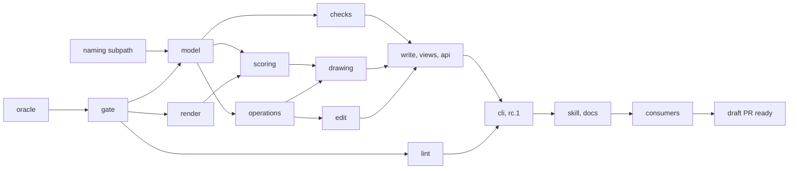

# Rebuild

How do we build 1.0 from zero without losing what today's code does right? The rebuild grows on the
branch `rebuild`, one draft PR into main; main keeps the old code and its fixes, and judges every difference.

## Where

| option | against it | verdict |
| --- | --- | --- |
| a new repository | loses the issues, the marketplace path, npm trusted publishing, the Homebrew job, the docs URL | no |
| refactor in place, module by module | new code bends to old seams: 231 model symbols, 64 folder cycles | fallback, if the owner stops the rebuild |
| main rebuilds, the old code on a fix branch | main has no working CLI for ≈ 40 PRs, and fixes need a second release line | no |
| a new tree beside `src/` | two gates and two document models in one tree | no |
| a branch `rebuild`, one draft PR rebased onto main; main keeps the old code and its fixes | one PR to review, always up to date with main, which the oracle has proven | **yes** |

- Main stays as users know it: the docs site, the marketplace through the `release` branch, releases at
  the owner's call. It takes fixes, no features, until 1.0.
- `rebuild` is rebased onto main whenever main moves, at the latest before a step starts. The rebase
  carries main's `docs/`, `plugins/`, `.github/`, changelog and version bumps along.
- After a rebase, `git diff <old base> <new base> -- src test` lists what main's new commits changed in
  the old code. Each change is ported into the new code, its regression becomes a named case, and when
  no input of `corpus/` reaches it, its input joins `corpus/`; old files the rebase touched or brought
  back are deleted again. So every fix reaches the rebuild, not only those the oracle's inputs happen to
  touch.
- The oracle builds main at the commit `rebuild` sits on, so between two rebases the judge stands still.
- This plan ends with the draft PR, not with a merge ([later](#later)).
- Operation JSON stays as on main but for these fields; `tools/oracle` maps them, so recorded edits replay:

| operation | today | 1.0 |
| --- | --- | --- |
| `add`, `retype` | `timer`, `message`, `error`, `errorCode`, `signal`, `escalation`, `escalationCode`, `when`, `link`, `nonInterrupting`, `doc`, `text` | the same names under `set` ([flag or key](flags.md#flag-or-keyvalue)) |
| `add` | `collapsed` | `set: { expanded: false }` |
| `connect` | `name`, `condition`, `language`, `default`, `message` | the same names under `set` |
| `remove` | `bridge: false`, `bridgeAll: true` | `bridge: "none"`, `bridge: "all"` |
| `add`, `retype` | `timerKind` | goes: `timer` tells the kinds apart |
| `set` | `values: { key: value }`, `unset: [key]` | `set: { key: value }`, and `set: { key: "" }` to unset |
| `move` | `flowName`, `flowId`, `condition`, `language`, `default` | go: `set` on the flow after the move |
| `tidy` | `path`, `via`, `kind`, `branch` | go: `ids` |
| `place`, `color` | `via`, `kind` | go: `branch`, or ids from `find --kind` |
| `align` | the operation | goes: one `place` per id |
| `layout` | no operation; `layoutXml` | new: redraws in full; its `expand` and `collapse` become `set: { expanded }` |

## What carries over

| ported: the algorithm or data, into new classes with new mirrored tests | written new |
| --- | --- |
| text preservation (262 of 265 no-ops on private real models byte-identical), both layouts (harness budget 264), the FEEL parser, the Camunda check rules, the codes; the id rules (`document/ids/`, 961 lines), since the edits probe compares ids; the inputs in `corpus/`; the 7 eval prompts | the CLI, the operation schema, the transaction, the result, the views, the contract, the render API, the help |

The 2,593 unit tests are not ported: they are a checklist, and the 23 fix commits' regressions become
named cases.

## Oracle

`tools/oracle` runs main and the rebuild on the same input and asks main for every answer: main at the
commit `rebuild` sits on, built in a worktree and cached by that commit. A rebase moves it to main's new
head.

Until the write step, each new module is judged through an entry of its own in `tools/oracle/entries/`,
added in its step's first commit: render's is the package's `.`, for the image probe; lint's is
`ProjectLint` against main's `projectBpmnlint` (`src/node.ts:68`), for the findings probe, and beside it
`lint-cli`, `ProjectLint` against bpmnlint 12's own CLI on the projects with their plugin installed; model,
checks, drawing and edit follow. An entry with `sidesFor` names both sides of an input itself. Until the step is done, an entry reports its differences in CI and
fails only when their count per probe rises above the count kept in `tools/oracle/progress.json`; the
commit that finishes the step makes it gate. A rebase that changes main's answers updates
`progress.json` in the same rebase. The write step removes the module entries and the CLI step `lint`:
from then on the oracle compares only the public surface, but for `lint-cli`, which stays and gates, as
bpmnlint 12's CLI answers no public call.

Each probe comes with the step that first needs it, and so does its folder of `corpus/`; the tables name
the step. Every recording runs main's own tools in main's worktree, so no probe needs a tool the gate
step deletes, and a rebase records again what main's new commits change. Main answers on every run, and
the codes come from its `kindsJson()`. Words of this section:

- a walk is one recorded run of today's fuzz tool (`tools/fuzz/`): a list of steps, each the operations and the
  file before them; `--mode incremental` is the layout mode it ran in;
- main answers a walk step through `mutateDoc`, its internal write, once with `layout: false` (the file
  after the model operations, before any drawing) and once with the layout;
- roundtrip is `tools/roundtrip.mjs`: per model a no-op, a rename and an insert whose bytes it compares;
- a phase is `before` or `after`: a host validator runs on the file before and after the change.

| folder | holds | step |
| --- | --- | ---: |
| `models/` | 52 fixtures | 3 |
| `layout/` | the 115 layout scenarios from `tools/scenarios/`, each with main's score over all 26 kinds; `scores.json`, main's counts per kind on every corpus file | 3 |
| `edits/` | per model roundtrip's three edits, and the edits `tools/bench/gen-edits.mjs` generates, written out as operation JSON | 3 |
| `lint/` | the 10 examples of [process-engine-blueprints](https://github.com/Miragon/process-engine-blueprints), each its `.bpmnlintrc`, its models, 36 in all, and its `package.json`, which the oracle installs so that the project's plugin runs (0.17.0 there); plus models for each case `packages/lint` handles | 6 |
| `design-iq/` | the arguments of design-iq's `bpmn-edit*.test.ts` calls, and the paths of `OPS_SCHEMA` it reads. The operations step runs those tests in a design-iq checkout, its head on that day, recorded in `COMMIT`, and the write step runs them again on design-iq's head then; a shim installed in place of `@miragon/bpmn-cli` logs each call, and a Proxy around `OPS_SCHEMA` logs each read. Main answers the calls, with each validator answer per phase; plus one written call per row of design-iq's [map](modules.md#contract) that its tests do not reach, such as `showXml` with `scope`. It needs a design-iq checkout, so `node tools/oracle/design-iq-record.mjs [checkout]` records it, not `npm run oracle:record` | 8 |
| `engine/` | the cases of main's 8 test files that run against live engines, as `.bpmn`: `parity/`, the 1,076 models of #123's 109 rule specs, synthetic, and `parity/codes.json` with the code each case declares; `verdicts/`, the 421 verdicts of Camunda 7.24, CIB seven 2.2, Operaton 2.1.5 and Camunda 8.9.22 that main's tests record: `c7-profile` 82, `c8-profile` 151, `c7-profile-rules` 55, `c8-feel-and-deploy` 58, `c7-schema-rules` 33, `c8-values` 27, `e2e/camunda7-rules` 15; `fixed/`, the 5 models `c8-ops` fixes, which must deploy; `feel/`, the 762 FEEL verdicts of main's FEEL tests; `structure/`, models and main's findings for what the structure checks refuse. Each row names the class whose rule it tests | 9 |
| `walks/` | the fuzz walks in `--mode incremental`, per step the operations and the file before. Main answers through `mutateDoc`: the file after `layout: false` with `changes.created`, `changes.relocated` and the expansion requests, and the file after the layout. `npm run oracle:record walks` records 16 walks of 10 steps over the small models, 4 MB | 11 |
| `scoring/` | small models, one or two per scoring criterion, each with the problem it shows; `ScoringCriterion`'s test runs every criterion on them | 10 |
| `cli/` | one golden call per kept command and flag | 14 |

| probe | input | must match | may differ | step |
| --- | --- | --- | --- | ---: |
| bytes | `corpus/edits/`: roundtrip's no-op (`set` a name to itself), rename and insert | bytes where main keeps them; changed lines ≤ main's | | 3 |
| findings | corpus for Camunda 7, Camunda 8 and no engine; `corpus/lint/` from step 6, `corpus/engine/` from step 9 | code, severity and element | wording | 3 |
| layout | 115 scenarios drawn in full; from step 11 each walk step's model operations drawn incrementally from its `layout: false` file, and each walk step with drawing operations run on its file before | the total over the 115 scenarios and the total over the walk steps no higher than main's, as main's `tools/bench/regress-gate.mjs` judges its total today | coordinates; the score of one file or step, and a hard defect main lacks there: the probe lists them, as the fuzz's `--hard warn` does | 3 |
| image | corpus, every plane | ≤ 0.5 % of pixels differ, both rasterised by the same resvg-wasm | SVG bytes | 3 |
| edits | `corpus/walks/` replayed, the bench edits of `corpus/edits/`, `corpus/design-iq/` | semantics without DI, ids, created, changed and removed, refusal codes, the host-validator findings added and those from before (`preexisting`) | DI, the result fields the allow-list names | 12 |
| CLI | `corpus/cli/` | exit code; in `--json`, the fields the edits and findings probes compare; `validate`'s `valid, N warning(s)` and `- N refused at deploy` (3 eval graders match them) | other JSON fields, other text | 14 |

- Only the allow-list `tools/oracle/differences.json` (probe, pattern, reason) may differ. It starts with
  what goes on the [commands](cli.md#commands) and [flags](flags.md) pages, the
  [behaviour that goes](cli.md#behaviour-that-goes), and, for `corpus/lint/`, the plugin
  [decision](README.md#decisions); bpmnlint 11.15 and 12.0 ship the same rules and configs, so their
  change needs no row.
- The [layout score](modules.md#layout-score) is the weighted sum of layout problems; lower is better.
  The oracle's score is the harness score: the 17 kinds that today's `tools/layout-regress.mjs` sums,
  which main's gate holds at 264 over the 115 scenarios (`tools/bench/regress-budget.json`). Hard defects are the kinds the layout score
  weights 6 or more.
- The fuzz counts hard defects as errors by default; `--hard warn` counts them as warnings, so a run
  goes on and the layout probe judges them.
- The layout probe scores both sides with main's scorers, run in main's worktree at the commit
  `rebuild` sits on: layout-regress's analyser and weights for the score, and main's
  `layoutProblemsOfXml` for the hard defects. After 1.0
  both come from the tag `pre-1.0`, since 1.0 exports no scorer. The rebuild's `Scorer` never grades
  itself here; the fuzz and the bench use the same scorers. `Scorer`'s mirrored test holds it to main's
  counts per kind in `corpus/layout/scores.json`.
- design-iq's recorded calls reach 1.0 through `tools/oracle/design-iq-map`, the
  [map](modules.md#contract).
- A rebase that brings a fix changes main's answers; the same rebase ports the fix or names it in the
  list.
- After 1.0 the oracle compares the last release with main.

`npm run oracle` judges (`--probe`, `--entry`, `--filter`, `--jobs`) and leaves its result in
`.oracle/result.json`; `npm run oracle:record` records `corpus/` again; `npm run oracle:selftest` runs main
against itself twice and plants one change per probe in a throwaway copy of the build. A later probe, entry
or recording is one file in `tools/oracle/probes/`, `entries/` or `recordings/`, and its proof one in
`plants/`. An entry named in `progress.json` reports up to its counts; any other entry gates, so the commit
that finishes a step removes its row.

## Order

| step | ≈ lines | ≈ commits | why here |
| --- | ---: | ---: | --- |
| naming subpath | in the plugin | 1 | model and `cli/files` read id conventions without bpmnlint |
| oracle, gate | 2.5k in `tools/` | 6 | no code without a judge and a gate; each later probe comes with the step that first needs it |
| render | 2.1k | 3 | small and standalone; scoring and drawing need its `./text` |
| lint | 0.8k | 2 | needs nothing of the core |
| model | 6.7k | 5 | every module reads it |
| operations, checks | 1.2k, 5.6k | 2, 5 | need only model; checks runs beside drawing |
| scoring | 1.4k | 2 | needs only model and render's `./text`; drawing judges its moves with it |
| drawing | 14.5k | 10 | the largest risk, so it starts as soon as operations and scoring exist; recorded walks judge it without edit |
| edit | 7.5k | 6 | beside drawing |
| write, views, api | 4.4k | 4 | joins the three siblings |
| cli | 1.9k | 3 | the top layer |

≈ 46k lines in `src/` and `packages/` as estimated, 51.3k as [measured](README.md#the-line-target-missed), ≈ 2.5k in `tools/`, ≈ 48 commits in one draft PR, and one PR in the plugin; no estimate in weeks.

## Releases

| line | until the draft PR is done | after a merge |
| --- | --- | --- |
| main, the old code | fixes only; releases as today, at the owner's call | 1.x only; no fix line for the old code |
| `@miragon/bpmn-cli` from `rebuild` | nothing until the CLI step, then `1.0.0-rc.N` on `next`; moves neither the `release` branch nor the Homebrew tap; bumps no plugin file | `1.0.0` from main on `latest`; the `release` branch and the tap follow as with every release |
| `packages/render` | private, built into the core's library and CLI | published as `@miragon/bpmn-render` only when its [trigger](README.md#triggers) fires |
| `packages/lint` | private, built into the core's CLI | published only when its [trigger](README.md#triggers) fires |

Today `release-please.yml` publishes without `--tag`, feeds the tap on every release and bumps the
skill's pin. release-please does not run on `rebuild`: a rebase replaces the commits its tags name, and
its release PR would be a second PR. From the CLI step on, `release-please.yml` on `rebuild` also runs
on a pushed tag `v1.0.0-rc.N`: it publishes that commit, whose `package.json` holds the same version,
with `--tag next`, and feeds no tap. The file keeps its name, so npm's trusted publishing, which trusts
`release-please.yml`, accepts it.

From rc.1 the contract is frozen: the API report changes only to fix a bug, named in the next rc's
notes, so design-iq's branch breaks only on purpose.

Why 1.0.0, not 0.10: the rebuild is the one break, with an API report from day one; more 0.x minors
invite today's churn of 15 repo-wide restructures in 20 days.

## Done

The draft PR is done when, rebased onto main's head:

1. Oracle: 0 differences outside the allow-list, in every probe, over the whole corpus.
2. The 79 private real models, kept outside the repository ([testing](../testing.md#private-corpora)), run
   locally: the bytes and layout probes no worse than main.
3. One live run over `corpus/engine/` on the release candidate agrees with every recorded verdict on the
   four engines.
4. Each eval, with the graders unchanged, scores on the release candidate at least as on main, median of
   3 runs each.
5. design-iq green on the release candidate in its own CI, on a branch of its own, and bpmn-to-code's
   skills name no retired command or flag.
6. Every hard [guardrail](code.md#guardrails) green; `bpmn add` on a Camunda 8 model of 500 nodes no
   slower than main on the same machine, best of 5 run in turn, as load only ever adds time; 7 nightly fuzz runs in a row without an
   error-severity violation, with hard layout defects counted as warnings (`--hard warn`, as in today's
   gate); the layout probe judges those against main.

## Later

Merging the draft PR and shipping 1.0.0 are not part of this plan. For that day:

- Main's ruleset asks for linear history; the PR merges by rebase, without conflicts, so release-please
  reads each commit's `BREAKING CHANGE:` footer into the 1.0.0 changelog.
- release-please goes back to main's release line with `release-as: 1.0.0`; with
  `bump-minor-pre-major` it would propose 0.10.0 for a breaking change.
- Main's last commit before the merge is tagged `pre-1.0`, from which the oracle takes main's scorers.
- Merge and publish 1.0.0 on the same day: the docs site deploys on every push to main, and
  bpmn-to-code's marketplace takes the bpmn-cli plugin from `ref: main` (`marketplace.json:19`), so
  both show 1.0 with the merge.

## Steps

The [checklist](README.md#steps) orders the steps. Each step is one commit or a few in the draft PR,
whose CI runs the gate on every push. A commit that changes what a user types or reads carries a
`BREAKING CHANGE:` footer that says what to use instead. Every step keeps green what earlier steps set, and every oracle
entry that already gates; only knip's production run reports the modules unused until write, views and
api import them in step 13.

### 2. Naming subpath

Publish `./naming` from `@miragon/bpmnlint-plugin-rules`.

- Today: bpmn-cli reads `element-id-naming`'s options through bpmnlint (`IdConventionsReader.ts`). The
  plugin, at 0.19.0, exports the rule, which loads only `bpmnlint-utils`, but not its defaults or its
  option reader.
- After: the plugin exports `./naming`, the rule's defaults and its option reader, without bpmnlint;
  model takes the defaults, `cli/files` reads conventions with it.
- Files: Miragon/bpmnlint-rules, the one change outside the draft PR.
- Done when: on npm, and it loads in Node and in a browser bundle without bpmnlint.

### 14. CLI and rc.1

Build the CLI and ship 1.0.0-rc.1.

- Today: 29 command classes; help in TypeScript.
- After: the [target](cli.md#target), help in Markdown, one esbuild bundle with `packages/lint` inside,
  release candidates as [above](#releases).
- Files: `src/cli/`, `bin/bpmn.js`, `test/cli/`, `test/e2e/`, `corpus/cli/`, `tools/fuzz/`,
  `tools/bench/`, the tag job in `release-please.yml`, the nightly workflow, and in
  `tools/check-budgets.mjs` the measures of the commands, flag slots and the guide's 20 KB.
- Done when: the CLI probe green, text results ≤ 1 KB, `--version` ≤ 60 ms, rc.1 on `next`; nightly
  fuzz and bench ran on it.

### 15. Skill, evals and docs

Update the skill and its evals, rework the docs.

- Today: all describe main's CLI; `docs/architecture.md` walks today's layers in 377 lines.
- After: 1.0, with a migration note; project lint findings come only from `bpmn validate`; element
  properties are `key=value`; builds over several writes end with `bpmn layout`; the
  [architecture doc](modules.md#architecture-doc) as a compact map.
- Files: `plugins/bpmn-cli/`, `docs/`, `test/contract/`, `test/e2e/plugin.test.ts`.
- Done when: same graders, no eval worse than on main (median of 3).
